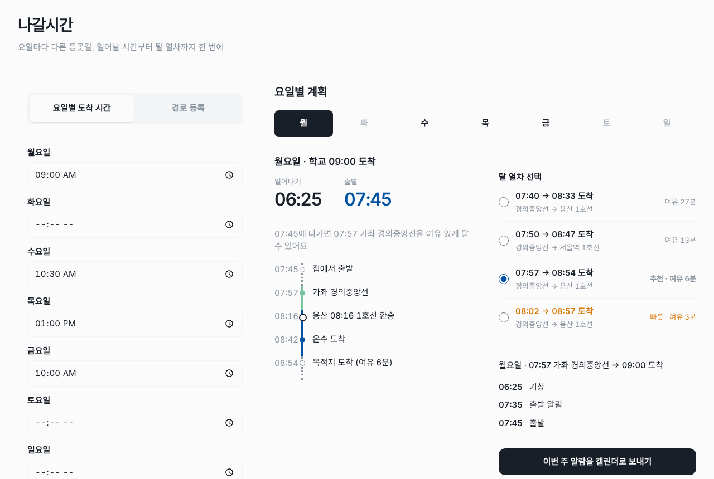
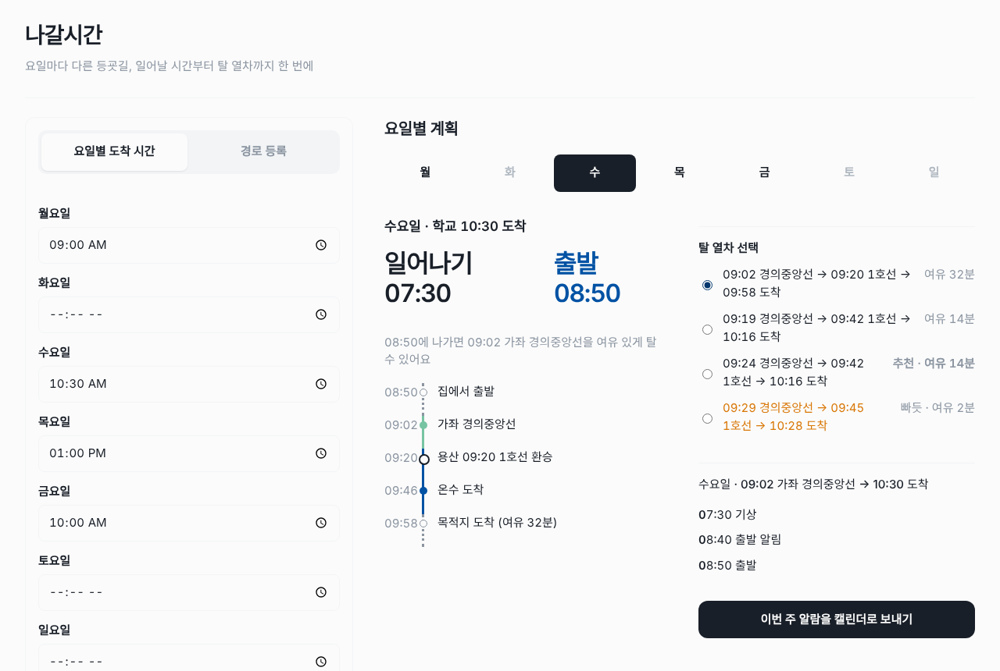
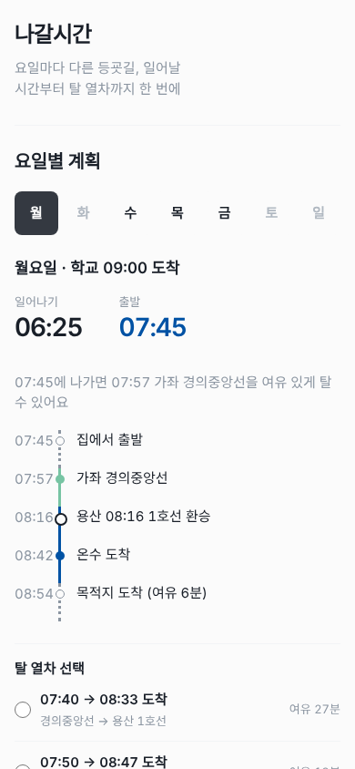
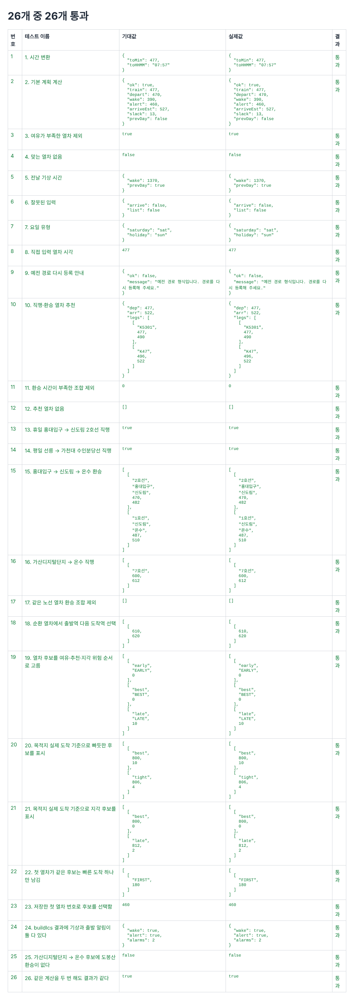

# 나갈시간

요일마다 다른 등굣길을 위해, 일어날 시간부터 탈 열차까지 한 번에 계산해 주는 웹 앱입니다.

- 데모 사이트: <https://oosohow.github.io/nagaltime/>
- 저장소: <https://github.com/oosohow/nagaltime>
- 만든 사람: 소프트웨어융합학부 202417072 김현민 (AI활용프로그래밍 기말 프로젝트)



## 1. 프로젝트 소개

### 해결하려는 문제

수업 시간이 요일마다 다르면 매일 밤 "내일 몇 시 열차를 타야 하지?", "그럼 몇 시에 일어나야 하지?"를 다시 계산해야 합니다. 환승이 있으면 더 복잡합니다. 지도 앱은 "지금 출발"하는 경로는 잘 알려 주지만, 요일별로 반복되는 기상·출발 시간과 알람까지 정리해 주지는 않습니다.

### 해결 방법

**출발역, 도착역, 요일별 도착 시간**만 입력하면 실제 열차 시간표로 탈 열차(직행 또는 환승 1회)를 추천하고, 출발 시간·기상 시간·알람을 계산합니다. 계산한 알람은 매주 반복되는 캘린더 일정(`.ics`)으로 내보낼 수 있습니다.

## 2. 주요 기능

| 번호 | 기능 | 설명 |
|---|---|---|
| F1 | 경로 등록 | 이름, 출발역, 도착역, 집→출발역 도보 시간, 도착역→목적지 도보 시간, 준비 시간을 저장합니다. 시간표가 없는 구간은 "직접 입력" 방식으로 열차 시각을 적을 수 있습니다. |
| F2 | 요일별 도착 시간 | 월~일 요일마다 목적지 도착 시간을 입력합니다. 비워 두면 "안 감"으로 처리합니다. 입력하는 즉시 저장됩니다. |
| F3 | 열차 추천 | 직행과 환승 1회 경로 중 늦지 않는 **가장 늦은 열차**를 추천합니다. |
| F4 | 다른 열차 선택 | 더 이른 열차 2개와 다음 열차 1개(빠듯/지각)를 함께 보여 주고, 원하는 열차를 고르면 요일별로 기억합니다. |
| F5 | 요일별 계획 | 요일 탭을 누르면 그날의 기상·출발 시간과 이동 경로(타임라인)를 보여 줍니다. |
| F6 | 알람 목록 | 기상, 출발 10분 전 알림, 출발 시간을 시간순으로 보여 줍니다. |
| F7 | 캘린더로 보내기 | 요일별 기상·출발 알림을 매주 반복 일정으로 담은 `nagalsigan.ics` 파일을 내려받습니다. |

**지원 노선**: 1호선, 2호선, 7호선, 경의중앙선, 경춘선, 서해선, 수인분당선 (평일 / 토요일·휴일)

## 3. 실행 방법

설치할 것이 없습니다. 아래 두 방법 중 하나를 사용하세요.

### 방법 1. 데모 사이트 (권장)

브라우저에서 <https://oosohow.github.io/nagaltime/> 에 접속합니다. 휴대폰과 PC 모두 됩니다.

### 방법 2. 내 컴퓨터에서 실행

```bash
git clone https://github.com/oosohow/nagaltime.git
```

또는 GitHub에서 **Code → Download ZIP**으로 내려받아 압축을 풉니다. 그다음 폴더 안의 `index.html`을 더블클릭하면 브라우저에서 열립니다.

- 순수 HTML·CSS·JavaScript만 사용해서 빌드나 서버가 필요 없고, `file://`로 열어도 동작합니다.
- 실행 중에는 외부 API를 호출하지 않습니다. 시간표는 미리 받아 `data/trips.js`에 넣어 두었습니다.

### 테스트 실행

`tests.html`을 브라우저에서 열면 테스트 결과 표가 나옵니다. (7장 참고)

## 4. 사용법

### 1) 경로 등록

처음 열면 **경로 등록** 탭이 열립니다. 이름(예: 학교), 출발역, 도착역을 입력하고 도보 시간과 준비 시간을 적은 뒤 **저장**을 누릅니다. 역 이름은 입력하면 목록에서 고를 수 있습니다.

- 최소 여유(기본 5분)와 환승 시간(기본 4분)은 **더 보기**에서 바꿀 수 있습니다.
- 시간표가 없는 구간은 등록 방식을 **직접 입력**으로 바꾸고 열차 시각을 `07:47, 07:57`처럼 적습니다.


### 2) 요일별 도착 시간 입력

**요일별 도착 시간** 탭에서 요일마다 목적지에 도착해야 하는 시간을 입력합니다. 가지 않는 요일은 비워 둡니다. 경로가 두 개 이상이면 요일마다 경로도 고를 수 있습니다.

### 3) 요일별 계획 확인

위쪽 요일 탭을 누르면 그날의 **일어나기·출발 시간**, 이동 경로, 알람 목록이 나옵니다.


### 4) 다른 열차 고르기

**탈 열차 선택**에서 다른 열차를 고르면 기상·출발 시간이 다시 계산됩니다. 고른 열차는 요일별로 저장됩니다.

- **추천**: 늦지 않는 가장 늦은 열차
- **여유 N분**: 더 일찍 출발하는 열차
- **빠듯**: 도착 시간은 지키지만 최소 여유보다 적게 남는 열차 (주황색)
- **지각 N분**: 도착 시간보다 늦는 열차



### 5) 캘린더로 보내기

**이번 주 알람을 캘린더로 보내기**를 누르면 `nagalsigan.ics` 파일을 내려받습니다. 이 파일을 휴대폰이나 Google 캘린더에서 열면 요일마다 기상·출발 알림이 매주 반복 일정으로 추가됩니다.

### 휴대폰 화면



## 5. 계산 방법

시간은 내부적으로 "자정부터 몇 분"인 숫자로 계산합니다. (예: 07:57 → 477)

1. **마감** = 도착 시간 − 최소 여유 − 도착역→목적지 도보 시간
2. 출발역에서 도착역까지 가는 **직행**과 **환승 1회** 경로를 모두 찾습니다.
   - 환승역에서는 환승 시간(기본 4분) 이상 기다릴 수 있는 열차만 이어 붙입니다.
   - 같은 노선끼리는 환승으로 보지 않습니다.
   - 2호선처럼 같은 역을 두 번 지나는 순환 열차는 출발역 **다음에** 나오는 도착역을 사용합니다.
3. 마감 안에 도착하는 경로 중 **가장 늦게 출발하는 열차**를 추천합니다.
4. 출발 = 첫 열차 시각 − 집→출발역 도보 시간
5. 기상 = 출발 − 준비 시간 (자정을 넘기면 "전날"로 표시)
6. 출발 알림 = 출발 − 10분

### 예시: 월요일 09:00까지 온수역 근처 학교 도착

가좌역 출발, 집→가좌 12분, 온수→학교 12분, 준비 80분, 최소 여유 5분

- 마감 = 09:00 − 5분 − 12분 = **08:43** (온수역에 이때까지 도착해야 함)
- 추천: **07:57 가좌 경의중앙선** → 08:10 용산 → **08:16 1호선** → 08:42 온수
- 목적지 도착 08:54 (여유 6분)
- 출발 = 07:57 − 12분 = **07:45**
- 기상 = 07:45 − 80분 = **06:25**
- 출발 알림 = **07:35**

## 6. 파일 구성

```text
.
├── index.html              # 메인 화면
├── tests.html              # 테스트 결과 화면
├── css/
│   └── style.css           # 화면 스타일 (휴대폰·PC 반응형)
├── data/
│   └── trips.js            # 열차별 정차역·시각 데이터 (tools로 생성, 직접 수정하지 않음)
├── js/
│   ├── time.js             # "HH:MM" ↔ 분 변환
│   ├── calc.js             # 열차 추천과 기상·출발 계산
│   ├── storage.js          # localStorage 저장·불러오기
│   ├── ics.js              # 캘린더(.ics) 파일 만들기
│   └── ui.js               # 화면 그리기와 이벤트 연결
├── tests/
│   └── tests.js            # 테스트 코드
├── tools/                  # 시간표 데이터를 만드는 스크립트 (앱 실행에는 필요 없음)
│   ├── convert_korail.py   # 코레일 xlsx → trips.js
│   ├── fetch_kric.py       # 레일포털 API에서 시간표 받기
│   ├── fetch_seoul.py      # 서울 열린데이터광장 API에서 2호선 주말 시간표 받기
│   └── merge_kric.js       # 받은 시간표를 trips.js에 합치기
├── docs/                   # API 문서, 원본 시간표, 스크린샷
└── .github/
    └── copilot-instructions.md  # Copilot 작업 지침
```

**설계 원칙**

- 스크립트는 `<script src>` 순서로 불러옵니다. (모듈·빌드 도구 없이 `file://`에서도 동작)
- 계산 함수는 오류가 나면 예외를 던지지 않고 `{ ok: false, message }`를 돌려줍니다. 화면은 이 메시지를 그대로 보여 줍니다.
- localStorage 접근은 `try/catch`로 감싸서, 저장이 막힌 환경에서도 화면이 깨지지 않습니다.

## 7. 테스트

`tests.html`을 열면 26개 테스트가 실행되고, 기대값과 실제값을 표로 보여 줍니다.

**결과: 26개 중 26개 통과**



| 분류 | 테스트 |
|---|---|
| 기본 계산 | 1 시간 변환 · 2 기본 계획 계산 · 3 여유가 부족한 열차 제외 · 5 전날 기상 시간 |
| 예외 처리 | 4 맞는 열차 없음 · 6 잘못된 입력 · 9 예전 경로 다시 등록 안내 · 12 추천 열차 없음 |
| 입력·요일 | 7 요일 유형 · 8 직접 입력 열차 시각 |
| 열차 추천 | 10 직행·환승 추천 · 11 환승 시간이 부족한 조합 제외 · 17 같은 노선 환승 제외 · 18 순환 열차 도착역 선택 |
| 실제 노선 | 13 휴일 홍대입구→신도림 2호선 · 14 평일 선릉→가천대 수인분당선 · 15 홍대입구→신도림→온수 환승 · 16 가산디지털단지→온수 7호선 |
| 후보 선택 | 19 여유·추천·지각 후보 순서 · 20 빠듯 표시 · 21 지각 표시 · 22 같은 첫 열차 중복 제거 · 23 저장한 열차 선택 · 25 반대 방향으로 돌아가는 비효율 후보 제외 |
| 안정성 | 26 같은 계산을 두 번 해도 결과가 같음 (역 목록 재사용 확인) |
| 캘린더 | 24 .ics에 기상·출발 알림 포함 |

## 8. 데이터 출처

| 노선 | 출처 |
|---|---|
| 1호선, 경의중앙선, 경춘선, 서해선 | 코레일 수도권 광역전철 열차시각표 (2026-08-28 시행, xlsx) |
| 2호선 평일, 7호선, 수인분당선 | 레일포털(KRIC) 열차 시간표 API |
| 2호선 토요일·휴일 | 서울 열린데이터광장 지하철 열차 시간표 API (getTrainSch) |

- API는 `tools/`의 스크립트로 **한 번만** 받아서 `data/trips.js`로 만들었습니다. 앱은 실행 중 API를 호출하지 않습니다.
- 인증키는 실행할 때 환경 변수로 넣고, 저장소에는 올리지 않았습니다.

## 9. 한계와 완성하지 못한 부분

| 내용 | 이유 |
|---|---|
| 환승은 1회까지만 지원 | 2회 이상은 경우의 수가 크게 늘어 계산이 느려지고, 등하교 경로 대부분이 1회 환승으로 충분했습니다. |
| 토요일은 휴일 시간표 사용 | 레일포털 API에 토요일 데이터가 비어 있는 노선이 많아 휴일 시간표로 통일했습니다. |
| 실시간 지연 미반영 | 실시간 API는 "지금 몇 분 뒤 도착"만 알려 줘서, 내일 아침 기상 시간 계산에는 쓸 수 없습니다. |
| 3·4·5·6·8·9호선, 신분당선, 공항철도 등 미포함 | 노선마다 데이터를 받고 검증하는 시간이 필요해, 실제 사용자 경로에 필요한 노선부터 넣었습니다. 같은 도구로 추가할 수 있습니다. |
| 공휴일 자동 인식 없음 | 공휴일 목록을 따로 관리해야 해서 제외했습니다. |
| 기기마다 따로 등록 | 저장소가 브라우저 localStorage라서, 다른 기기나 브라우저에서는 다시 등록해야 합니다. |

## 10. 계획과 달라진 점

1. **입력 방식**: 처음에는 노선·역·방향을 고르고 시간표에서 열차를 고르는 방식이었습니다. 직접 써 보니 입력할 것이 많고, 환승이 있으면 사용자가 직접 계산해야 해서 쓸모가 없었습니다. 그래서 **출발역·도착역만 넣으면 환승까지 열차를 추천**하는 방식으로 바꿨고, "시간표 선택" 등록 방식은 없앴습니다.
2. **노선 확대**: 경의중앙선·1호선에서 2호선, 7호선, 수인분당선 등으로 늘렸습니다. 코레일 시간표에 없는 노선은 공공 API로 받았습니다.
3. **열차 후보**: 열차 하나만 보여 주던 것을 이른 열차·추천·다음 열차까지 4개로 보여 주고 고를 수 있게 했습니다.
4. **화면**: 월~일을 한 번에 보여 주던 표를 요일 탭으로 바꾸고, 휴대폰에서 보기 쉬운 단순한 디자인으로 바꿨습니다.
5. **배포**: Docker를 검토했지만, 서버가 필요 없는 정적 사이트라서 GitHub Pages로 배포했습니다.

## 11. GitHub Copilot 활용

| 기능 | 활용 내용 |
|---|---|
| 지침 파일 | `.github/copilot-instructions.md`에 프로젝트 규칙(순수 HTML·CSS·JS, 오류는 `{ok:false,message}`로 반환 등)을 적어 매번 같은 스타일로 생성되게 했습니다. |
| Chat | 기능 단위로 프롬프트를 나눠 경로 등록 → 계산 → 화면 → 캘린더 순으로 구현했습니다. 작업 내용을 인수인계 문서로 정리해 새 대화에서도 맥락을 이어 갔습니다. |
| 테스트 | 각 기능을 만들 때 테스트를 함께 요청해 26개 테스트를 작성했습니다. |
| 디버깅 | 아래 사례처럼 증상을 설명하고 원인을 찾게 했습니다. |
| 리팩토링 | 코드 리뷰를 요청해 개선 항목을 고르고 적용했습니다. |
| 데이터 도구 | API 응답을 trips.js 형식으로 합치는 `merge_kric.js`를 Copilot으로 작성했습니다. |

### 디버깅 사례

| 증상 | 원인 | 수정 |
|---|---|---|
| 캘린더 버튼을 눌러도 아무 일도 없음 | `handleIcsDownload` 함수가 `renderPlan` 안에 들어가 있어 이벤트에 연결되지 않음 | 함수를 바깥으로 꺼내 버튼에 연결 |
| 직접 입력한 열차 시각이 새로고침 후 깨짐 | 열차 시각을 분(숫자)으로 저장하고 불러올 때는 "HH:MM"으로 읽음 | 저장 형식을 "HH:MM" 문자열로 통일 |
| 일정이 있는 날에 캘린더 버튼이 안 보임 | 버튼 표시 조건이 반대로 되어 있었음 | 계획이 하나라도 있으면 버튼을 보이게 수정 |
| 13:30 도착인데 13:26 도착 열차가 "지각 위험"으로 표시 | 최소 여유를 못 지키는 경우를 모두 "지각"으로 처리 | 도착 시간 안이면 "빠듯", 넘으면 "지각"으로 구분하고 테스트 추가 |
| 가산디지털단지→온수에서 7호선으로 도봉산까지 갔다가 돌아오는 "지각 148분" 후보가 나옴 | 추천 열차 바로 다음 출발이면 경로가 비효율적이어도 후보로 넣음 | 더 늦게 출발하고 더 일찍 도착하는 경로가 있으면 제외하고 테스트 25 추가 |

### 리팩토링 전/후

**1. `renderPlan` 나누기**

- 전: `renderPlan` 한 함수가 요일 탭, 계획 카드, 열차 후보, 알람 목록, 버튼을 모두 그렸습니다. 함수가 길어 어디를 고쳐야 할지 찾기 어려웠고, 위의 `handleIcsDownload` 버그도 여기서 생겼습니다.
- 후: `renderPlanCard`, `renderPlanDetails`, `renderTripOptions`, `renderAlarmList`, `renderPlanError`로 나눴습니다. `renderPlan`은 탭을 만들고 이 함수들을 부르기만 합니다.

**2. 쓰지 않는 "시간표 선택" 방식 제거**

- 전: 경로 종류가 "시간표 선택 / 직접 입력 / 열차 추천" 세 가지였고, 계산·저장·화면 코드마다 세 갈래 분기가 있었습니다. `data/timetable.js`도 따로 필요했습니다.
- 후: 열차 추천이 시간표 선택을 대신하므로 해당 방식과 `timetable.js`를 지웠습니다. 분기가 두 갈래로 줄었고, 예전 형식으로 저장된 경로는 "다시 등록해 주세요" 메시지를 보여 줍니다. (테스트 9)

**3. 열차 추천 계산 함수 분리**

- 전: `calcPlan` 함수 **안에** `calcTripPlan` 함수가 중첩되어 있었고, 분을 0~1439로 맞추는 `normalize`가 두 곳에 똑같이 들어 있었습니다. 또 계산할 때마다 역별 열차 목록(역 인덱스)을 처음부터 다시 만들었습니다.
- 후: `calcTripPlan`을 바깥 함수로 꺼내고 `normalizeMinute` 하나로 합쳤습니다. 역 인덱스는 `getStationIndex`가 한 번만 만들고 `WeakMap`에 저장해 재사용합니다. (테스트 26)

## 12. 사용 기술

- HTML, CSS, JavaScript (프레임워크·라이브러리 없음)
- localStorage (브라우저 저장)
- iCalendar(.ics) 형식 (캘린더 내보내기)
- Python, Node.js (시간표 데이터 생성 도구)
- GitHub Pages (배포), GitHub Copilot (개발)
