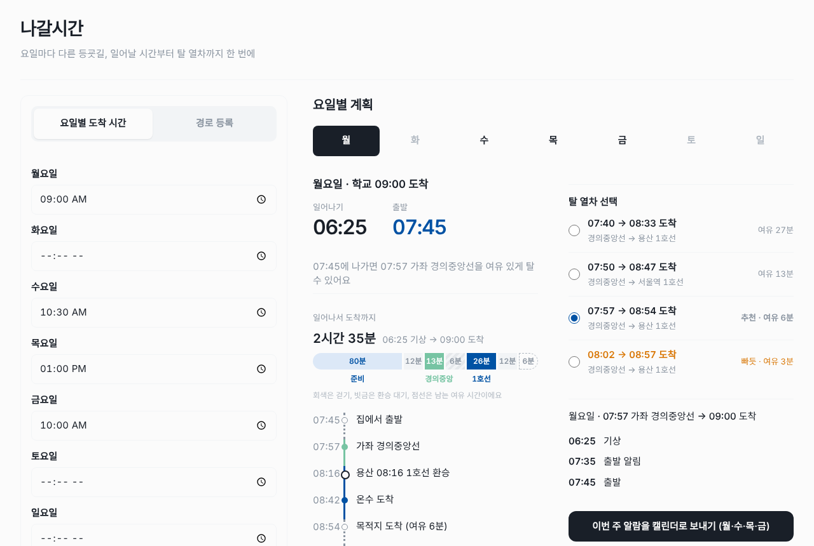
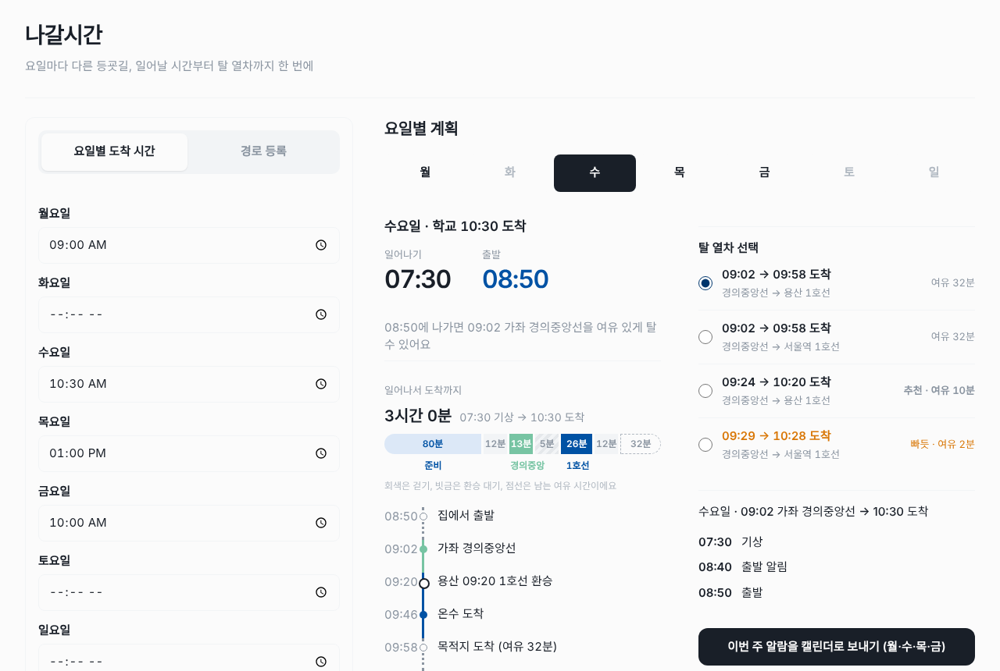
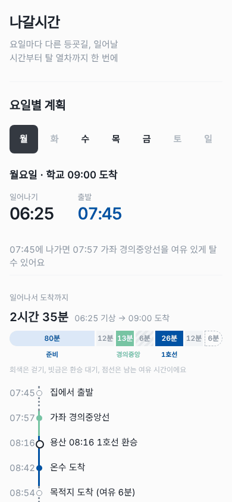
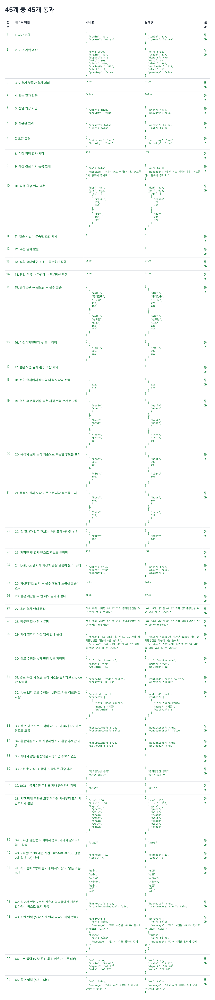

# 나갈시간

요일마다 다른 등굣길을 위해, 일어날 시간부터 탈 열차까지 한 번에 계산해 주는 웹 앱입니다.

- 데모 사이트: <https://oosohow.github.io/nagaltime/>
- 만든 사람: 소프트웨어융합학부 202417072 김현민 (AI활용프로그래밍 기말 프로젝트)



## 1. 프로젝트 소개

### 해결하려는 문제

수업 시간이 요일마다 다르면 매일 밤 "내일 몇 시 열차를 타야 하지?", "그럼 몇 시에 일어나서 준비 하지?"를 다시 계산해야 합니다. 환승이 있으면 더 복잡합니다. 지도 앱은 "지금 출발"하는 경로는 잘 알려 주지만, 요일별로 반복되는 기상·출발 시간과 알람까지 정리해 주지는 않습니다.

### 해결 방법

**출발역, 도착역, 요일별 도착 시간**만 입력하면 실제 열차 시간표로 탈 열차(직행 또는 환승 1회)를 추천하고, 출발 시간·기상 시간·알람을 계산합니다. 계산한 알람은 매주 반복되는 캘린더 일정(`.ics`)으로 내보낼 수 있습니다.

## 2. 주요 기능

| 번호 | 기능 | 설명 |
|---|---|---|
| F1 | 경로 등록·수정 | 이름, 출발역, 도착역, 집→출발역 도보 시간, 도착역→목적지 도보 시간, 준비 시간을 저장합니다. 원하는 **환승역**을 지정할 수 있고, 저장한 경로는 **수정**·삭제할 수 있습니다. 시간표가 없는 구간은 "직접 입력" 방식으로 열차 시각을 적을 수 있습니다. |
| F2 | 요일별 도착 시간 | 월~일 요일마다 목적지 도착 시간을 입력합니다. 비워 두면 "안 감"으로 처리합니다. 입력하는 즉시 저장됩니다. |
| F3 | 열차 추천 | 직행과 환승 1회 경로 중 늦지 않는 **가장 늦은 열차**를 추천합니다. |
| F4 | 다른 열차 선택 | 더 이른 열차 2개와 다음 열차 1개(빠듯/지각)를 함께 보여 주고, 원하는 열차를 고르면 요일별로 기억합니다. |
| F5 | 요일별 계획 | 요일 탭을 누르면 그날의 기상·출발 시간, **일어나서 도착까지 시간 막대**(준비·도보·열차·환승·여유), 이동 경로(타임라인)를 보여 줍니다. |
| F6 | 알람 목록 | 기상, 출발 10분 전 알림, 출발 시간을 시간순으로 보여 줍니다. |
| F7 | 캘린더로 보내기 | 요일별 기상·출발 알림을 매주 반복 일정으로 담은 `nagalsigan.ics` 파일을 내려받습니다. |

**지원 노선**: 서울 지하철 1~9호선, 경의중앙선, 수인분당선, 공항철도 (평일 / 토요일·휴일). 3호선 일산선, 4호선 진접·과천·안산선, 8호선 별내선 직통 구간과 9호선 급행·공항철도 직통열차도 포함합니다.

## 3. 실행 환경

이 앱은 브라우저만 있으면 실행됩니다. 설치할 패키지가 없어서 `requirements.txt`나 `package.json`도 없습니다.

| 구분 | 필요한 것 |
|---|---|
| 앱 실행 | 최신 웹 브라우저 (Chrome, Edge, Safari, Firefox). PC·휴대폰 모두 가능 |
| 필요한 패키지 | **없음** (순수 HTML·CSS·JavaScript, 프레임워크·라이브러리·빌드 도구 없음) |
| 인터넷 | 데모 사이트로 열 때만 필요. 내려받은 폴더의 `index.html`은 인터넷 없이도 동작 |
| 테스트 실행 | 앱과 같음 (브라우저로 `tests.html` 열기) |
| 시간표 데이터 다시 만들기 (선택) | Python 3.9 이상, Node.js 18 이상, 레일포털·서울 열린데이터광장 인증키. 앱을 실행하거나 채점하는 데는 필요 없음 |

시간표 데이터를 다시 만들 때만 아래 명령이 필요합니다.

```bash
KRIC_KEY='레일포털 인증키' python3 tools/fetch_kric.py --line 1호선,경의중앙선   # 노선별 시간표 받기 (노선 생략 시 전체)
SEOUL_KEY='서울 열린데이터 인증키' python3 tools/fetch_seoul.py            # 2호선 주말 시간표 받기
node tools/merge_kric.js                    # 받은 시간표로 data/trips.js 만들기
```

## 4. 설치·실행 방법

### 방법 1. 데모 사이트 (권장)

브라우저에서 <https://oosohow.github.io/nagaltime/> 에 접속합니다. 휴대폰과 PC 모두 됩니다. `main` 브랜치에 push하면 GitHub Pages가 자동으로 다시 배포합니다.

### 방법 2. 내 컴퓨터에서 실행

```bash
git clone https://github.com/oosohow/nagaltime.git
cd nagaltime
open index.html          # macOS
start index.html         # Windows
xdg-open index.html      # Linux
```

또는 GitHub에서 **Code → Download ZIP**으로 내려받아 압축을 풀고 `index.html`을 더블클릭해도 됩니다.

- 빌드나 서버 없이 `file://`로 열어도 동작합니다.
- 실행 중에는 외부 API를 호출하지 않습니다. 시간표는 미리 받아 `data/trips.js`에 넣어 두었습니다.

### 테스트 실행 방법

저장소 폴더에서 아래 명령으로 `tests.html`을 엽니다. 화면 맨 위에 "42개 중 42개 통과"가 나오면 성공입니다.

```bash
open tests.html          # macOS
start tests.html         # Windows
xdg-open tests.html      # Linux
```

데모 사이트에서도 바로 실행할 수 있습니다: <https://oosohow.github.io/nagaltime/tests.html>

## 5. 사용법

### 1) 경로 등록

처음 열면 **경로 등록** 탭이 열립니다. 이름(예: 학교), 출발역, 도착역을 입력하고 도보 시간과 준비 시간을 적은 뒤 **저장**을 누릅니다. 역 이름은 입력하면 목록에서 고를 수 있습니다.

- 최소 여유(기본 5분)와 환승 시간(기본 4분)은 **더 보기**에서 바꿀 수 있습니다.
- 늘 갈아타는 역이 정해져 있으면 **더 보기 → 환승역(선택)**에 적습니다. 예를 들어 가좌→월계에서 `회기`를 적으면 회기에서 1호선으로 갈아타는 열차만 추천합니다. 비워 두면 가장 늦게 나가도 되는 경로를 자동으로 찾습니다.
- 저장한 경로는 목록에서 **수정**을 눌러 고칠 수 있습니다. 수정해도 요일별 도착 시간은 그대로 남고, 경로가 바뀌었으니 직접 고른 열차만 초기화됩니다.
- 시간표가 없는 구간은 등록 방식을 **직접 입력**으로 바꾸고 열차 시각을 `07:47, 07:57`처럼 적습니다.


### 2) 요일별 도착 시간 입력

**요일별 도착 시간** 탭에서 요일마다 목적지에 도착해야 하는 시간을 입력합니다. 가지 않는 요일은 비워 둡니다. 경로가 두 개 이상이면 요일마다 경로도 고를 수 있습니다.

### 3) 요일별 계획 확인

위쪽 요일 탭을 누르면 그날의 **일어나기·출발 시간**, 이동 경로, 알람 목록이 나옵니다.

**일어나서 도착까지** 막대는 기상부터 목적지 도착까지를 준비·도보·열차·환승 대기·여유로 나눠, 각 구간 길이를 걸리는 시간에 비례해 보여 줍니다. 지도 앱은 집에서 나서는 순간부터 시간을 재지만, 나갈시간은 일어나는 순간부터 잽니다.


### 4) 다른 열차 고르기

**탈 열차 선택**에서 다른 열차를 고르면 기상·출발 시간이 다시 계산됩니다. 고른 열차는 요일별로 저장됩니다.

- **추천**: 늦지 않는 가장 늦은 열차
- **여유 N분**: 더 일찍 출발하는 열차
- **빠듯**: 도착 시간은 지키지만 최소 여유보다 적게 남는 열차 (주황색)
- **지각 N분**: 도착 시간보다 늦는 열차



### 5) 캘린더로 보내기

**이번 주 알람을 캘린더로 보내기**를 누르면 `nagalsigan.ics` 파일을 내려받습니다. 이 파일을 휴대폰이나 Google 캘린더에서 열면 요일마다 기상·출발 알림이 매주 반복 일정으로 추가됩니다.

### 휴대폰 화면



## 6. MVP 체크리스트

중간고사 계획서의 MVP(F1~F6)와 선택 기능(F7~F9)을 기준으로 정리했습니다.

**상태: ✅ 완성 · 🔶 부분 완성 · ❌ 미완성**

| 번호 | 계획서 기능 | 상태 | 확인 근거 | 완성하지 못한 부분과 이유 |
|---|---|---|---|---|
| F1 | 목적지별 경로 등록 | 🔶 | 학교·아르바이트처럼 경로를 여러 개 저장, 걷는 시간·준비·최소 여유 등록, 시간표 없는 구간은 HH:MM 직접 입력과 형식 오류 안내 (테스트 6·8), 평일·토·일 시간표 자동 적용 | **버스 경로 등록은 하지 않았습니다.** 배차 간격으로 다니는 버스는 정해진 시각표가 없어 열차와 같은 방식으로 계산할 수 없고, 지하철 노선을 넓히는 것을 우선했습니다. 버스 시각을 알면 "직접 입력"으로 대신할 수 있습니다. 노선·역·방면을 고르는 방식은 출발역·도착역 입력으로 바꿨습니다(7장). |
| F2 | 요일별 입력·저장 | 🔶 | 요일마다 경로와 도착 시각만 입력, localStorage에 저장되어 새로고침해도 유지, 시간 입력칸이 잘못된 시각을 받지 않음 | **요일마다 준비 시간을 따로 바꾸는 기능은 없습니다.** 준비 시간은 경로에 저장하는 값이라, 다른 준비 시간이 필요한 요일은 준비 시간만 다른 경로를 하나 더 만들어 고르면 됩니다. 요일마다 입력칸을 늘리면 "요일마다 입력 2개 이하"라는 사용성 목표와 부딪혀서 이 방식을 택했습니다. |
| F3 | 열차 선택·출발·기상 계산 | ✅ | 계획서 예시(도착 09:00, 열차 07:47·07:57·08:07, 탑승 후 50분, 도보 7분, 준비 80분, 최소 여유 10분)와 결과(07:57 열차, 08:47 도착, 여유 13분, 출발 07:50, 기상 06:30, 알림 07:40)가 **테스트 2와 똑같이** 나옴. 열차 추천은 환승 1회까지 확장 | 출발 알림은 출발 10분 전으로 고정했습니다(계획서에는 사용자가 바꿀 수 있다고 적음). 버스 계산은 F1과 같은 이유로 제외했습니다. |
| F4 | 요일별 계획표 | ✅ | 기상·출발·탑승 열차·도착 예상·여유 표시, 처음 열면 오늘 요일 선택, 전날로 넘어가는 기상은 "(전날)" 표시. 계획서 예시(월 00:30 탑승, 도보 20분, 준비 80분 → 기상 22:50 전날)가 **테스트 5와 같음** | 월~일을 한 표에 모두 보여 주던 계획을 **요일 탭으로 하루씩** 보여 주도록 바꿨습니다(7장). |
| F5 | 요일별 알람 목록 | ✅ | 요일 탭을 누르면 그날의 기상·출발 알림·출발만 시간순으로 표시되고 다른 요일 알람은 섞이지 않음 | 전날 울리는 기상 알람은 일정 요일 탭에 "(전날)"로 표시합니다. 캘린더 파일에는 실제로 울리는 전날 요일로 들어갑니다. |
| F6 | 캘린더 내보내기 | ✅ | 저장된 모든 요일의 기상·출발 알림을 매주 반복(RRULE)과 알림(VALARM)이 있는 `nagalsigan.ics` 하나로 저장 (테스트 24) | 없음 |
| F7 (선택) | 알람 목록 복사 | ❌ | — | 캘린더 내보내기(F6)로 알람을 옮기는 목적이 해결되어 우선순위를 낮췄습니다. |
| F8 (선택) | 놓쳤을 때 다음 열차 | ✅ | 추천 열차 다음 열차를 "빠듯"(주황) 또는 "지각 N분"(빨강)으로 함께 보여 주고, 다른 열차를 골라 다시 계산할 수 있음 (테스트 19~21) | 없음 |
| F9 (선택) | 경로·시간표 자동 등록 (ODsay API) | 🔶 | ODsay 대신 공공 시간표(레일포털·서울 열린데이터)를 미리 받아 두고, 출발역·도착역만 넣으면 환승까지 자동으로 찾게 함 | 실행 중에 API를 부르지 않는 방식으로 바꿨습니다. 앱이 외부 서비스에 기대지 않아 실패 위험이 없고, 계획서의 "HTML을 직접 열어도 동작" 조건도 지킵니다. 집·학교 위치로 걷는 시간을 자동으로 넣는 부분은 하지 않았습니다. |

### 비기능 요구사항 확인

| 분류 | 계획서 요구사항 | 결과 |
|---|---|---|
| 정확성 | 실제로 쓰던 알람 시간과 일치 | 가좌 07:57 경의중앙선 → 용산 08:16 1호선 → 온수 08:42로, 실제 통학 열차와 같은 열차가 추천됨 (8장 예시) ✅ |
| 실행 환경 | 서버 없이 PC 브라우저에서 동작 | `index.html`을 직접 열어도 동작 ✅. 데모를 위해 GitHub Pages 배포를 추가 |
| 사용성 | 경로 등록 후 요일마다 입력 2개 이하, 요일을 누르면 그날 알람만 | 요일마다 경로·도착 시각 2개(경로가 하나면 1개) ✅ |
| 신뢰성 | 자정 넘김·잘못된 값·맞는 열차 없음에도 멈추지 않음 | 계산 함수는 오류 대신 `{ ok: false, message }`를 돌려주고 화면에 이유를 표시. 테스트 4·5·6·12 ✅ |
| 개인정보 | 일정·경로를 외부 서버로 보내지 않음 | localStorage에만 저장, 실행 중 외부 요청 없음 ✅ |

## 7. 계획 변경 사항

중간고사 계획서와 달라진 내용과 이유입니다.

| 계획서 | 바뀐 결과 | 이유 |
|---|---|---|
| 노선·역·방면을 고르고, 탑승 후 이동 시간을 직접 입력 | **출발역·도착역만 입력**하면 시간표에서 직행·환승 1회 열차를 자동 추천. 탑승 시간도 시간표에서 계산 | 직접 써 보니 입력할 것이 많고, 환승이 있으면 "몇 시 열차를 타야 갈아탈 열차와 맞는지"를 여전히 사람이 계산해야 했습니다. 머리로 하기 귀찮은 부분이 바로 이 환승 계산이라서 앱이 맡도록 바꿨습니다. |
| 통학 노선(1호선 용산~온수, 2호선, 경의중앙선)부터 지원 | **서울 지하철 1~9호선, 경의중앙선, 수인분당선, 공항철도** | 친구들이 각자 경로로 써 보려면 노선이 더 필요했고, 데이터 수집 도구를 만들어 두니 노선 하나를 더하는 데 오래 걸리지 않았습니다. |
| F9 경로 자동 등록에 ODsay API 사용 | 공공 시간표를 미리 받아 `data/trips.js`로 정리 | 실행 중 API 호출은 실패 위험이 있고 키 관리도 필요합니다. 레일포털 담당자도 "하루 한 번 받아 두고 쓰라"고 안내했습니다. |
| 월~일 계획을 한 표에 표시 | 요일 탭으로 하루씩 표시, 그날의 **일어나서 도착까지 시간 막대** 추가 | 휴대폰 화면에서 7일 표는 글자가 너무 작았습니다. 하루씩 보여 주는 대신, 준비·이동·여유가 한눈에 보이는 막대로 이 앱이 지도 앱과 다른 점(일어나는 순간부터 계산)을 드러냈습니다. |
| 열차 하나만 계산 | 이른 열차 2개·추천·다음 열차(빠듯/지각)를 보여 주고 고를 수 있게 함 | 선택 기능 F8(놓쳤을 때 다음 열차)을 같은 화면에서 해결했습니다. |
| (없음) | **환승역 지정**, **경로 수정**, 같은 이름의 다른 역 구분 | 친구에게 써 보게 했더니 실제로 타는 경로(가좌→회기→월계)가 나오지 않았습니다. 시간표상 같은 도착 시각이어도 사람마다 갈아타는 역이 달라서 환승역을 고를 수 있게 했고, 값 하나 바꾸려고 경로를 지웠다 다시 만들지 않도록 수정 기능을 넣었습니다. |
| 버스 평균 이동 시간 등록, 요일별 준비 시간 변경 | 하지 않음 | 6장 MVP 체크리스트의 F1·F2 참고 |
| 웹사이트 배포는 범위에서 제외 | **GitHub Pages로 배포** | 기말 발표를 데모 사이트로 시연하라는 안내가 있었고, 정적 사이트라 서버 없이 배포할 수 있었습니다. Docker도 검토했지만 서버가 필요 없는 앱이라 쓰지 않았습니다. |
| console.assert로 테스트 | `tests.html`에서 42개 테스트를 표로 보여 주고 `console.assert`도 함께 실행 | 통과·실패를 한눈에 보고 제출용 결과 화면을 남기기 위해서입니다. |

## 8. 계산 방법

시간은 내부적으로 "자정부터 몇 분"인 숫자로 계산합니다. (예: 07:57 → 477)

1. **마감** = 도착 시간 − 최소 여유 − 도착역→목적지 도보 시간
2. 출발역에서 도착역까지 가는 **직행**과 **환승 1회** 경로를 모두 찾습니다.
   - 환승역에서는 환승 시간(기본 4분) 이상 기다릴 수 있는 열차만 이어 붙입니다.
   - 같은 노선끼리는 환승으로 보지 않습니다.
   - 2호선처럼 같은 역을 두 번 지나는 순환 열차는 출발역 **다음에** 나오는 도착역을 사용합니다.
3. 마감 안에 도착하는 경로 중 **가장 늦게 출발하는 열차**를 추천합니다.
4. 출발 = 첫 열차 시각 − 집→출발역 도보 시간
5. 기상 = 출발 − 준비 시간 (자정을 넘기면 "전날"로 표시)
6. 출발 알림 = 출발 − 10분

### 예시: 월요일 09:00까지 온수역 근처 학교 도착

가좌역 출발, 집→가좌 12분, 온수→학교 12분, 준비 80분, 최소 여유 5분

- 마감 = 09:00 − 5분 − 12분 = **08:43** (온수역에 이때까지 도착해야 함)
- 추천: **07:57 가좌 경의중앙선** → 08:10 용산 → **08:16 1호선** → 08:42 온수
- 목적지 도착 08:54 (여유 6분)
- 출발 = 07:57 − 12분 = **07:45**
- 기상 = 07:45 − 80분 = **06:25**
- 출발 알림 = **07:35**

## 9. 테스트

`tests.html`을 열면 42개 테스트가 실행되고, 번호·테스트 이름·기대값·실제값·결과가 표로 나옵니다. 같은 결과가 브라우저 개발자 도구 콘솔에도 `console.assert`로 남습니다. 실행 방법은 [4장](#4-설치실행-방법)을 보세요.

**결과: 42개 중 42개 통과**



| 분류 | 테스트 |
|---|---|
| 기본 계산 | 1 시간 변환 · 2 기본 계획 계산 · 3 여유가 부족한 열차 제외 · 5 전날 기상 시간 |
| **예외 처리** | 4 맞는 열차 없음 · 6 잘못된 입력("9시", "07:5x") · 9 예전 형식 경로 다시 등록 안내 · 12 없는 역이면 추천 없음 · 32 없는 경로 수정 · 35 지나지 않는 환승역 · 41 없는 역 이름 거부 |
| 입력·요일 | 7 요일 유형 · 8 직접 입력 열차 시각 |
| 열차 추천 | 10 직행·환승 추천 · 11 환승 시간이 부족한 조합 제외 · 17 같은 노선 환승 제외 · 18 순환 열차 도착역 선택 |
| 실제 노선 | 13 휴일 홍대입구→신도림 2호선 · 14 평일 선릉→가천대 수인분당선 · 15 홍대입구→신도림→온수 환승 · 16 가산디지털단지→온수 7호선 |
| 후보 선택 | 19 여유·추천·지각 후보 순서 · 20 빠듯 표시 · 21 지각 표시 · 22 같은 첫 열차 중복 제거 · 23 저장한 열차 선택 · 25 반대 방향으로 돌아가는 비효율 후보 제외 |
| 안정성 | 26 같은 계산을 두 번 해도 결과가 같음 (캐시 재사용 확인) |
| 안내 문장 | 27 추천 열차 · 28 빠듯한 열차 · 29 지각 열차와 직접 입력 |
| 경로 수정 | 30 id와 변경 값 저장 · 31 도착 시간은 유지하고 고른 열차만 초기화 · 32 없는 경로 수정은 null |
| 환승역 | 33 도착이 같으면 늦게 갈아타는 경로 선택 · 34 회기 지정 시 회기 환승만 추천 · 35 지나지 않는 환승역이면 후보 없음 |
| 5·6호선 | 36 가좌 → 공덕 → 광화문(5호선) 환승 · 37 6호선 응암순환을 지나 공덕 직행 |
| 시간 막대 | 38 준비·도보·열차·환승·여유 구간 합계가 기상부터 도착까지 시간과 같음 |
| 3·9호선 | 39 일산선 대화 → 종로3가 직통 · 40 9호선 11/16 개편 시간표(출근 시간대 급행 2대·일반 1대) 반영 |
| 역 이름 | 41 '신촌역'·'서울'처럼 '역'이 붙거나 빠져도 찾고 없는 역은 거부 · 42 떨어져 있는 2호선 신촌과 경의중앙선 신촌을 환승역으로 쓰지 않음 |
| 캘린더 | 24 .ics에 기상·출발 알림 포함 |

## 10. 리팩토링 전/후

**1. `renderPlan` 나누기**

- 전: `renderPlan` 한 함수가 요일 탭, 계획 카드, 열차 후보, 알람 목록, 버튼을 모두 그렸습니다. 함수가 길어 어디를 고쳐야 할지 찾기 어려웠고, 위의 `handleIcsDownload` 버그도 여기서 생겼습니다.
- 후: `renderPlanCard`, `renderPlanDetails`, `renderTripOptions`, `renderAlarmList`, `renderPlanError`로 나눴습니다. `renderPlan`은 탭을 만들고 이 함수들을 부르기만 합니다.

**2. 쓰지 않는 "시간표 선택" 방식 제거**

- 전: 경로 종류가 "시간표 선택 / 직접 입력 / 열차 추천" 세 가지였고, 계산·저장·화면 코드마다 세 갈래 분기가 있었습니다. `data/timetable.js`도 따로 필요했습니다.
- 후: 열차 추천이 시간표 선택을 대신하므로 해당 방식과 `timetable.js`를 지웠습니다. 분기가 두 갈래로 줄었고, 예전 형식으로 저장된 경로는 "다시 등록해 주세요" 메시지를 보여 줍니다. (테스트 9)

**3. 열차 추천 계산 함수 분리**

- 전: `calcPlan` 함수 **안에** `calcTripPlan` 함수가 중첩되어 있었고, 분을 0~1439로 맞추는 `normalize`가 두 곳에 똑같이 들어 있었습니다. 또 계산할 때마다 역별 열차 목록(역 인덱스)을 처음부터 다시 만들었습니다.
- 후: `calcTripPlan`을 바깥 함수로 꺼내고 `normalizeMinute` 하나로 합쳤습니다. 역 인덱스(`getStationIndex`)와 출발역·도착역별 경로 목록(`collectTrips`)은 한 번만 만들고 `WeakMap`에 저장해 재사용합니다. 요일 시간을 바꿀 때 걸리던 시간이 0.3~1초에서 0.2초 이하로 줄었습니다. (테스트 26)

**4. 쓰지 않는 코드와 중복 정리**

- 전: 기능을 여러 번 바꾸면서 쓰이지 않는 코드가 남았습니다. 어디에서도 부르지 않는 `isPrevDay`, 다른 함수를 그대로 부르기만 하는 `readTripNumber`, 앱에서는 안 쓰고 테스트에서만 쓰는 `findTrips`가 있었고, 요일 목록 `['mon', …, 'sun']`이 네 파일에 따로 적혀 있었습니다. `style.css`(982줄)는 디자인을 고칠 때마다 아래에 규칙을 덧붙여 같은 선택자가 여러 번 나오고, 600px 이하 화면 규칙이 네 군데로 흩어져 있었습니다.
- 후: 안 쓰는 함수를 지우고 `findTrips`는 테스트 파일의 도우미 함수로 옮겼습니다. 요일 목록은 `time.js`의 `DAY_KEYS` 하나를 모든 파일이 같이 씁니다. CSS는 같은 선택자를 하나로 합치고 덮여서 실제로는 쓰이지 않던 값을 지워 883줄로 줄였고, 화면 폭별 규칙을 맨 아래 두 블록(899px 이하, 600px 이하)에 모았습니다. 정리 전후로 PC·태블릿·휴대폰 화면 30장을 찍어 픽셀 단위로 비교해 화면이 바뀌지 않은 것을 확인했고, 테스트 42개도 그대로 통과합니다.

**5. 시간표 데이터 만드는 방법 통일**

- 전: 1호선·경의중앙선은 코레일 엑셀 4개를 `tools/convert_korail.py`로 바꾸고, 나머지 노선은 레일포털 API로 받아 `merge_kric.js`가 기존 `trips.js`에 덧붙였습니다. 출처가 둘이라 역 이름(항공대/한국항공대 등)을 따로 맞춰야 했고, 엑셀 변환 오류(11장 디버깅)도 생겼습니다.
- 후: 모든 노선을 레일포털·서울 열린데이터에서 받고, `merge_kric.js`가 기존 파일을 읽지 않고 `trips.js`를 처음부터 만듭니다. 엑셀 4개와 변환 스크립트를 지워 파일이 5개 줄었고, 열차 수(평일 5,364개·휴일 4,795개)는 그대로이며 테스트 42개가 통과합니다.

## 11. 개발 과정

### Copilot Chat 활용

먼저 `.github/copilot-instructions.md`에 프로젝트 규칙(순수 HTML·CSS·JS, `file://`에서 동작, 실행 중 API 호출 금지, 시간은 분 단위 정수, 오류는 `{ ok: false, message }`로 반환)을 적어 두어, 어떤 대화에서 요청해도 같은 구조로 코드가 나오게 했습니다. 기능은 한 번에 만들어 달라고 하지 않고 "경로 등록 → 계산 → 화면 → 캘린더" 순으로 나눠 요청했고, 요청할 때마다 계획서처럼 목적·입력 예시·기대 결과·예외 상황을 함께 적었습니다. 그래서 계획서의 예시(07:57 열차, 기상 06:30)가 그대로 테스트 2번이 되었습니다.

대화가 길어지면 맥락이 끊겨서, 지금까지의 결정과 남은 작업을 인수인계 문서(`docs/인수인계.md`, 개인정보가 들어 있어 제출 전 저장소에서 삭제)로 정리해 새 대화에 넘겼습니다. 넘긴 뒤에는 "추천 열차를 고르는 기준이 뭐야?" 같은 질문을 먼저 던져 Copilot이 문서를 제대로 이해했는지 확인하고 작업을 시작했습니다. 시간표 API 응답을 `trips.js` 모양으로 합치는 `tools/merge_kric.js`도 응답 예시를 보여 주고 Copilot Chat으로 작성했습니다.

### 디버깅

가장 기억에 남는 사례는 "빠듯"과 "지각"의 구분입니다. 13:30까지 가야 하는 날 13:26에 도착하는 열차가 "지각 위험"으로 표시됐습니다. 증상과 함께 계산에 쓴 값(도착 시간, 최소 여유, 마지막 도보)을 Copilot에 보여 주자, 최소 여유를 지키지 못하는 경우를 모두 "지각"으로 처리하고 있다는 원인을 찾았습니다. 도착 시간 안이면 "빠듯", 넘으면 "지각"으로 나누고, 같은 실수가 다시 생기지 않도록 테스트 20·21을 추가했습니다. 그 밖의 사례는 아래 표에 정리했습니다.

| 증상 | 원인 | 수정 |
|---|---|---|
| 캘린더 버튼을 눌러도 아무 일도 없음 | `handleIcsDownload` 함수가 `renderPlan` 안에 들어가 있어 이벤트에 연결되지 않음 | 함수를 바깥으로 꺼내 버튼에 연결 |
| 직접 입력한 열차 시각이 새로고침 후 깨짐 | 열차 시각을 분(숫자)으로 저장하고 불러올 때는 "HH:MM"으로 읽음 | 저장 형식을 "HH:MM" 문자열로 통일 |
| 일정이 있는 날에 캘린더 버튼이 안 보임 | 버튼 표시 조건이 반대로 되어 있었음 | 계획이 하나라도 있으면 버튼을 보이게 수정 |
| 13:30 도착인데 13:26 도착 열차가 "지각 위험"으로 표시 | 최소 여유를 못 지키는 경우를 모두 "지각"으로 처리 | 도착 시간 안이면 "빠듯", 넘으면 "지각"으로 구분하고 테스트 추가 |
| 가산디지털단지→온수에서 7호선으로 도봉산까지 갔다가 돌아오는 "지각 148분" 후보가 나옴 | 추천 열차 바로 다음 출발이면 경로가 비효율적이어도 후보로 넣음 | 더 늦게 출발하고 더 일찍 도착하는 경로가 있으면 제외하고 테스트 25 추가 |
| 친구 경로(가좌→회기→월계)가 추천에 안 나오고 용산·서울역 환승만 나옴 | 같은 1호선 열차를 용산·청량리·회기 어디서 갈아타도 도착 시간이 같아서, 처음 찾은 용산만 남김 | 도착이 같으면 늦게 갈아타는 경로를 남기고, 환승역을 직접 지정하는 옵션 추가 (테스트 33~35) |
| 1호선 동인천 급행(K1004)이 소사·온수에도 서는 것으로 나오고, 서울역에서 천안으로 가는 K1945가 신창에서 출발하는 것으로 나옴 | 코레일 엑셀을 변환할 때 열차가 그냥 지나가는 역의 통과 시각까지 정차로 읽었고, 일부 열차는 역 순서가 뒤집힘. 그 결과 실제로는 탈 수 없는 경로가 추천됨 | 1호선·경의중앙선도 다른 노선처럼 레일포털 API로 받아 데이터 만드는 방법을 하나로 통일 (10장 리팩토링 5). 바뀐 데이터에 맞춰 테스트 23 수정 |
| "신촌역"을 입력하면 목록에 없다고 거절되고, 2호선 신촌에서 경의중앙선으로 갈아타는 경로가 나옴 | 데이터의 역 이름은 "신촌"뿐이었고, 떨어져 있는 두 신촌역이 같은 이름이라 한 역으로 합쳐짐 (양평도 같은 문제) | 입력한 역 이름의 '역'을 자동으로 맞추고, 경의중앙선 쪽을 `신촌(경의중앙선)`·`양평(경의중앙선)`으로 분리 (테스트 41·42) |

### 코드 리뷰 반영

화면 코드(`js/ui.js`)가 길어지자 Copilot Chat에 코드 리뷰를 요청했고, 개선할 점을 번호를 붙인 표로 받았습니다. 그중 `renderPlan`(요일 탭·계획 카드·열차 후보·알람 목록·버튼을 한 함수에서 모두 그림)을 나누는 항목을 골라 적용했습니다. 앞의 디버깅 표에 있는 캘린더 버튼 버그도 이 함수가 너무 길어서 함수 안에 다른 함수가 잘못 들어가며 생긴 문제였습니다(10장 리팩토링 1).


## 12. 데이터 출처

| 노선 | 출처 |
|---|---|
| 1호선, 2호선 평일, 3~9호선, 경의중앙선, 수인분당선, 공항철도 | 레일포털(KRIC) 열차 시간표 API |
| 2호선 토요일·휴일 | 서울 열린데이터광장 지하철 열차 시간표 API (getTrainSch) |

- API는 `tools/`의 스크립트로 **한 번만** 받아서 `data/trips.js`로 만들었습니다. 앱은 실행 중 API를 호출하지 않습니다.
- 인증키는 실행할 때 환경 변수로 넣고, 저장소에는 올리지 않았습니다.
- 이름은 같지만 실제로는 떨어져 있어 갈아탈 수 없는 역은 노선 이름을 붙여 구분했습니다: `신촌`(2호선)과 `신촌(경의중앙선)`, `양평`(5호선)과 `양평(경의중앙선)`.

### 시간표 기준일 (2026-11-16 확인)

| 노선 | 기준 | 확인 내용 |
|---|---|---|
| 1호선, 경의중앙선 | 레일포털 API, 2026-11-18 내려받음 | 처음에는 코레일 엑셀 시각표(2026-08-28 시행)를 썼지만, 변환 오류가 있어 레일포털로 바꿈 (11장 디버깅) |
| 2호선 평일, 3~8호선, 수인분당선, 공항철도 | 레일포털 API, 2026-11-13·16 내려받음 | 응답에 기준일이 없어 내려받은 날짜를 기준으로 함. 2호선 평일은 서울 열린데이터와 대조해 일치 |
| 9호선 | 레일포털 API, 2026-11-16 내려받음 | 같은 날 시행된 개편(05:40~07:00 급행 2대·일반 1대, 출근 집중 운행 05:40부터) 반영 확인 (테스트 40) |
| 2호선 토요일·휴일 | 서울 열린데이터, 2025-05-01부터 유효 | 가장 오래된 데이터. 이후 개정 소식은 찾지 못함 |

임시 증편(수능 등)이나 파업처럼 하루 단위로 달라지는 운행은 반영하지 않습니다.

## 13. 한계

| 내용 | 이유 |
|---|---|
| 환승은 1회까지만 지원, 환승역은 1곳만 지정 | 2회 이상은 경우의 수가 크게 늘어 계산이 느려지고, 등하교 경로 대부분이 1회 환승으로 충분했습니다. |
| 토요일은 휴일 시간표 사용 | 레일포털 API에 토요일 데이터가 비어 있는 노선이 많아 휴일 시간표로 통일했습니다. |
| 실시간 지연 미반영 | 실시간 API는 "지금 몇 분 뒤 도착"만 알려 줘서, 내일 아침 기상 시간 계산에는 쓸 수 없습니다. |
| 신분당선, 경춘선, 서해선, GTX 등 미포함 | 사용자가 많은 서울 지하철 중심으로 넣었습니다. 경춘선·서해선은 데이터 크기를 줄이려고 뺐고, 같은 도구로 추가할 수 있습니다. |
| 공휴일 자동 인식 없음 | 공휴일 목록을 따로 관리해야 해서 제외했습니다. |
| 기기마다 따로 등록 | 저장소가 브라우저 localStorage라서, 다른 기기나 브라우저에서는 다시 등록해야 합니다. |

## 14. 파일 구성

```text
.
├── index.html              # 메인 화면
├── tests.html              # 테스트 결과 화면
├── css/
│   └── style.css           # 화면 스타일 (휴대폰·PC 반응형)
├── data/
│   └── trips.js            # 열차별 정차역·시각 데이터 (tools로 생성, 직접 수정하지 않음)
├── js/
│   ├── time.js             # "HH:MM" ↔ 분 변환, 공통 요일 목록
│   ├── calc.js             # 열차 추천과 기상·출발 계산
│   ├── storage.js          # localStorage 저장·불러오기
│   ├── ics.js              # 캘린더(.ics) 파일 만들기
│   └── ui.js               # 화면 그리기와 이벤트 연결
├── tests/
│   └── tests.js            # 테스트 코드
├── tools/                  # 시간표 데이터를 만드는 스크립트 (앱 실행에는 필요 없음)
│   ├── fetch_kric.py       # 레일포털 API에서 시간표 받기
│   ├── fetch_seoul.py      # 서울 열린데이터광장 API에서 2호선 주말 시간표 받기
│   └── merge_kric.js       # 받은 시간표로 trips.js 만들기
├── docs/                   # 기말 안내서, API 문서, 스크린샷 (docs/README.md 참고)
└── .github/
    └── copilot-instructions.md  # Copilot 작업 지침
```

**설계 원칙**

- 스크립트는 `<script src>` 순서로 불러옵니다. (모듈·빌드 도구 없이 `file://`에서도 동작)
- 계산 함수는 오류가 나면 예외를 던지지 않고 `{ ok: false, message }`를 돌려줍니다. 화면은 이 메시지를 그대로 보여 줍니다.
- localStorage 접근은 `try/catch`로 감싸서, 저장이 막힌 환경에서도 화면이 깨지지 않습니다.

## 15. 사용 기술

- HTML, CSS, JavaScript (프레임워크·라이브러리 없음)
- localStorage (브라우저 저장)
- iCalendar(.ics) 형식 (캘린더 내보내기)
- Python, Node.js (시간표 데이터 생성 도구)
- GitHub Pages (배포), GitHub Copilot (개발)
