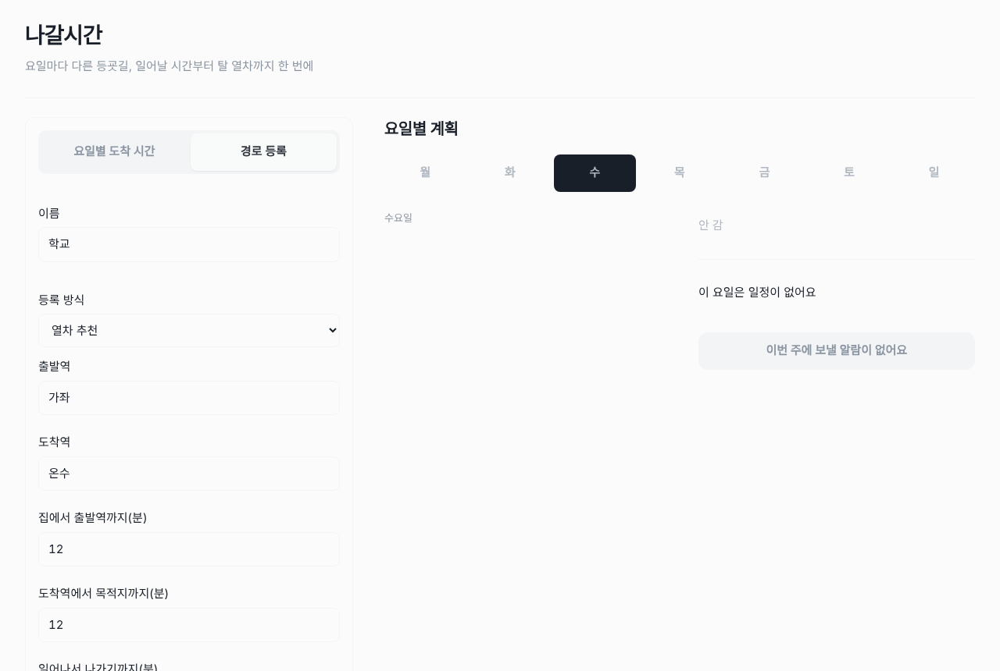

# 나갈시간

요일마다 다른 등굣길을 위해, 일어날 시간부터 탈 열차까지 한 번에 계산해 주는 웹 앱입니다.

- 데모 사이트: <https://oosohow.github.io/nagaltime/>
- 만든 사람: 소프트웨어융합학부 202417072 김현민 (AI활용프로그래밍 기말 프로젝트)


**5분 안에 써 보기**: ① 데모 사이트를 엽니다 → ② **경로 등록**에서 출발역·도착역·도보·준비 시간을 넣고 저장 → ③ **요일별 도착 시간**에 수업 시작 시각을 넣으면 → ④ 위쪽 요일 탭에 기상·출발 시간과 탈 열차가 나옵니다. 설치할 것은 없습니다.

| 목차 | |
|---|---|
| 쓰는 법 | [1. 소개](#1-프로젝트-소개) · [2. 기능](#2-주요-기능) · [3. 실행 환경](#3-실행-환경) · [4. 설치·실행](#4-설치실행-방법) · [5. 사용법](#5-사용법) |
| 만든 과정 | [6. MVP 체크리스트](#6-mvp-체크리스트) · [7. 계획 변경](#7-계획-변경-사항) · [8. 계산 방법](#8-계산-방법) · [9. 테스트](#9-테스트) · [10. 리팩토링](#10-리팩토링-전후) · [11. 개발 과정](#11-개발-과정) |
| 마무리 | [12. 데이터 출처·검증](#12-데이터-출처와-검증) · [13. 최종 점검](#13-최종-점검) · [14. 기술 포인트](#14-기술적-포인트) · [15. 한계와 개선](#15-한계와-개선-방향) · [16. 회고](#16-회고) · [17. 파일 구성](#17-파일-구성) |

## 1. 프로젝트 소개

### 해결하려는 문제

수업 시간이 요일마다 다르면 매일 밤 "내일 몇 시 열차를 타야 하지?", "그럼 몇 시에 일어나서 준비 하지?"를 다시 계산해야 합니다. 환승이 있으면 더 복잡합니다. 지도 앱은 "지금 출발"하는 경로는 잘 알려 주지만, 요일별로 반복되는 기상·출발 시간과 알람까지 정리해 주지는 않습니다.

### 해결 방법

**출발역, 도착역, 요일별 도착 시간**만 입력하면 실제 열차 시간표로 탈 열차(직행 또는 환승 1회)를 추천하고, 출발 시간·기상 시간·알람을 계산합니다. 계산한 알람은 매주 반복되는 캘린더 일정(`.ics`)으로 내보낼 수 있습니다.

## 2. 주요 기능

| 번호 | 기능 | 설명 |
|---|---|---|
| F1 | 경로 등록·수정 | 이름, 출발역, 도착역, 집→출발역 도보 시간, 도착역→목적지 도보 시간, 준비 시간을 저장합니다. 원하는 **환승역**을 지정할 수 있고, 저장한 경로는 **수정**·삭제할 수 있습니다. 시간표가 없는 구간은 "직접 입력" 방식으로 열차 시각을 적을 수 있습니다. |
| F2 | 요일별 도착 시간 | 월~일 요일마다 목적지 도착 시간을 입력합니다. 비워 두면 "안 감"으로 처리합니다. 입력하는 즉시 저장됩니다. |
| F3 | 열차 추천 | 직행과 환승 1회 경로 중 늦지 않는 **가장 늦은 열차**를 추천합니다. |
| F4 | 다른 열차 선택 | 더 이른 열차 2개와 다음 열차 1개(빠듯/지각)를 함께 보여 주고, 원하는 열차를 고르면 요일별로 기억합니다. |
| F5 | 요일별 계획 | 요일 탭을 누르면 그날의 기상·출발 시간, **일어나서 도착까지 시간 막대**(준비·도보·열차·환승·여유), 이동 경로(타임라인)를 보여 줍니다. |
| F6 | 알람 목록 | 기상, 출발 10분 전 알림, 출발 시간을 시간순으로 보여 줍니다. |
| F7 | 캘린더로 보내기 | 요일별 기상·출발 알림을 매주 반복 일정으로 담은 `nagalsigan.ics` 파일을 내려받습니다. |

**지원 노선**: 서울 지하철 1~9호선, 경의중앙선, 수인분당선, 공항철도 (평일 / 토요일·휴일). 3호선 일산선, 4호선 진접·과천·안산선, 8호선 별내선 직통 구간과 9호선 급행·공항철도 직통열차도 포함합니다.

## 3. 실행 환경

이 앱은 브라우저만 있으면 실행됩니다. 설치할 패키지가 없어서 `requirements.txt`나 `package.json`도 없습니다.

| 구분 | 필요한 것 |
|---|---|
| 앱 실행 | 최신 웹 브라우저 (Chrome, Edge, Safari, Firefox). PC·휴대폰 모두 가능 |
| 필요한 패키지 | **없음** (순수 HTML·CSS·JavaScript, 프레임워크·라이브러리·빌드 도구 없음) |
| 인터넷 | 데모 사이트로 열 때만 필요. 내려받은 폴더의 `index.html`은 인터넷 없이도 동작 |
| 테스트 실행 | 앱과 같음 (브라우저로 `tests.html` 열기) |
| 시간표 데이터 다시 만들기 (선택) | Python 3.9 이상, Node.js 18 이상, 레일포털·서울 열린데이터광장 인증키. 앱을 실행하거나 채점하는 데는 필요 없음 |

시간표 데이터를 다시 만들 때만 아래 명령이 필요합니다.

```bash
KRIC_KEY='레일포털 인증키' python3 tools/fetch_kric.py --line 1호선,경의중앙선   # 노선별 시간표 받기 (노선 생략 시 전체)
SEOUL_KEY='서울 열린데이터 인증키' python3 tools/fetch_seoul.py            # 2호선 시간표(평일·주말) 받기
node tools/merge_kric.js                    # 받은 시간표로 data/trips.js 만들기
```

## 4. 설치·실행 방법

### 방법 1. 데모 사이트 (권장)

브라우저에서 <https://oosohow.github.io/nagaltime/> 에 접속합니다. 휴대폰과 PC 모두 됩니다. `main` 브랜치에 push하면 GitHub Pages가 자동으로 다시 배포합니다.

### 방법 2. 내 컴퓨터에서 실행

```bash
git clone https://github.com/oosohow/nagaltime.git
cd nagaltime
open index.html          # macOS
start index.html         # Windows
xdg-open index.html      # Linux
```

또는 GitHub에서 **Code → Download ZIP**으로 내려받아 압축을 풀고 `index.html`을 더블클릭해도 됩니다.

- 빌드나 서버 없이 `file://`로 열어도 동작합니다.
- 실행 중에는 외부 API를 호출하지 않습니다. 시간표는 미리 받아 `data/trips.js`에 넣어 두었습니다.

### 테스트 실행 방법

저장소 폴더에서 아래 명령으로 `tests.html`을 엽니다. 화면 맨 위에 "45개 중 45개 통과"가 나오면 성공입니다.

```bash
open tests.html          # macOS
start tests.html         # Windows
xdg-open tests.html      # Linux
```

데모 사이트에서도 바로 실행할 수 있습니다: <https://oosohow.github.io/nagaltime/tests.html>

## 5. 사용법

### 1) 경로 등록

처음 열면 **경로 등록** 탭이 열립니다. 이름(예: 학교), 출발역, 도착역을 입력하고 도보 시간과 준비 시간을 적은 뒤 **저장**을 누릅니다. 역 이름은 입력하면 목록에서 고를 수 있습니다.

- 최소 여유(기본 5분)와 환승 시간(기본 4분)은 **더 보기**에서 바꿀 수 있습니다.
- 늘 갈아타는 역이 정해져 있으면 **더 보기 → 환승역(선택)**에 적습니다. 예를 들어 가좌→월계에서 `회기`를 적으면 회기에서 1호선으로 갈아타는 열차만 추천합니다. 비워 두면 가장 늦게 나가도 되는 경로를 자동으로 찾습니다.
- 저장한 경로는 목록에서 **수정**을 눌러 고칠 수 있습니다. 수정해도 요일별 도착 시간은 그대로 남고, 경로가 바뀌었으니 직접 고른 열차만 초기화됩니다.
- 시간표가 없는 구간은 등록 방식을 **직접 입력**으로 바꾸고 열차 시각을 `07:47, 07:57`처럼 적습니다.



### 2) 요일별 도착 시간 입력

**요일별 도착 시간** 탭에서 요일마다 목적지에 도착해야 하는 시간을 입력합니다. 가지 않는 요일은 비워 둡니다. 경로가 두 개 이상이면 요일마다 경로도 고를 수 있습니다.

### 3) 요일별 계획 확인

위쪽 요일 탭을 누르면 그날의 **일어나기·출발 시간**, 이동 경로, 알람 목록이 나옵니다.

**일어나서 도착까지** 막대는 기상부터 목적지 도착까지를 준비·도보·열차·환승 대기·여유로 나눠, 각 구간 길이를 걸리는 시간에 비례해 보여 줍니다. 지도 앱은 집에서 나서는 순간부터 시간을 재지만, 나갈시간은 일어나는 순간부터 잽니다.


### 4) 다른 열차 고르기

**탈 열차 선택**에서 다른 열차를 고르면 기상·출발 시간이 다시 계산됩니다. 고른 열차는 요일별로 저장됩니다.

- **추천**: 늦지 않는 가장 늦은 열차
- **여유 N분**: 더 일찍 출발하는 열차
- **빠듯**: 도착 시간은 지키지만 최소 여유보다 적게 남는 열차 (주황색)
- **지각 N분**: 도착 시간보다 늦는 열차


### 5) 캘린더로 보내기

**이번 주 알람을 캘린더로 보내기**를 누르면 `nagalsigan.ics` 파일을 내려받습니다. 이 파일을 휴대폰이나 Google 캘린더에서 열면 요일마다 기상·출발 알림이 매주 반복 일정으로 추가됩니다.

### 휴대폰 화면


## 6. MVP 체크리스트

중간고사 계획서의 MVP(F1~F6)와 선택 기능(F7~F9)을 기준으로 정리했습니다.

**상태: ✅ 완성 · 🔶 부분 완성 · ❌ 미완성**

| 번호 | 계획서 기능 | 상태 | 확인 근거 | 완성하지 못한 부분과 이유 |
|---|---|---|---|---|
| F1 | 목적지별 경로 등록 | 🔶 | 학교·아르바이트처럼 경로를 여러 개 저장, 걷는 시간·준비·최소 여유 등록, 시간표 없는 구간은 HH:MM 직접 입력과 형식 오류 안내 (테스트 6·8), 평일과 토요일·휴일 시간표 자동 적용 | 계획서의 **"버스는 평균 이동 시간을 등록"** 부분은 구현하지 않고 계획을 바꿨습니다(7장). 계획서는 토요일 시간표를 따로 쓰기로 했지만, 레일포털에 토요일 데이터가 비어 있는 노선이 많아 **토요일은 휴일 시간표**로 계산합니다. 노선·역·방면을 고르는 방식은 출발역·도착역 입력으로 바꿨습니다(7장). |
| F2 | 요일별 입력·저장 | 🔶 | 요일마다 경로와 도착 시각만 입력, localStorage에 저장되어 새로고침해도 유지, 시간 입력칸이 잘못된 시각을 받지 않음 | **요일마다 준비 시간을 따로 바꾸는 기능은 없습니다.** 준비 시간은 경로에 저장하는 값이라, 다른 준비 시간이 필요한 요일은 준비 시간만 다른 경로를 하나 더 만들어 고르면 됩니다. 요일마다 입력칸을 늘리면 "요일마다 입력 2개 이하"라는 사용성 목표와 부딪혀서 이 방식을 택했습니다. |
| F3 | 열차 선택·출발·기상 계산 | ✅ | 계획서 예시(도착 09:00, 열차 07:47·07:57·08:07, 탑승 후 50분, 도보 7분, 준비 80분, 최소 여유 10분)와 결과(07:57 열차, 08:47 도착, 여유 13분, 출발 07:50, 기상 06:30, 알림 07:40)가 **테스트 2와 똑같이** 나옴. 열차 추천은 환승 1회까지 확장 | 출발 알림은 출발 10분 전으로 고정했습니다(계획서에는 사용자가 바꿀 수 있다고 적음). 버스 계산은 F1과 같이 계획을 바꿨습니다(7장). |
| F4 | 요일별 계획표 | ✅ | 기상·출발·탑승 열차·도착 예상·여유 표시, 처음 열면 오늘 요일 선택, 전날로 넘어가는 기상은 "(전날)" 표시. 계획서 예시(월 00:30 탑승, 도보 20분, 준비 80분 → 기상 22:50 전날)가 **테스트 5와 같음** | 월~일을 한 표에 모두 보여 주던 계획을 **요일 탭으로 하루씩** 보여 주도록 바꿨습니다(7장). |
| F5 | 요일별 알람 목록 | ✅ | 요일 탭을 누르면 그날의 기상·출발 알림·출발만 시간순으로 표시되고 다른 요일 알람은 섞이지 않음 | 전날 울리는 기상 알람은 일정 요일 탭에 "(전날)"로 표시합니다. 캘린더 파일에는 실제로 울리는 전날 요일로 들어갑니다. |
| F6 | 캘린더 내보내기 | ✅ | 저장된 모든 요일의 기상·출발 알림을 매주 반복(RRULE)과 알림(VALARM)이 있는 `nagalsigan.ics` 하나로 저장 (테스트 24). 계획서의 확인 방법대로 macOS 캘린더에 가져와 매주 반복 일정과 알림이 등록되는 것을 확인 | 계획서는 출발 알림만 내보내기로 했지만 기상 알림도 함께 넣었습니다. |
| F7 (선택) | 알람 목록 복사 | ❌ | — | 캘린더 내보내기(F6)로 알람을 옮기는 목적이 해결되어 우선순위를 낮췄습니다. |
| F8 (선택) | 놓쳤을 때 다음 열차 | ✅ | 추천 열차 다음 열차를 "빠듯"(주황) 또는 "지각 N분"(빨강)으로 함께 보여 주고, 다른 열차를 골라 다시 계산할 수 있음 (테스트 19~21) | 없음 |
| F9 (선택) | 경로·시간표 자동 등록 (ODsay API) | 🔶 | ODsay 대신 공공 시간표(레일포털·서울 열린데이터)를 미리 받아 두고, 출발역·도착역만 넣으면 환승까지 자동으로 찾게 함 | 실행 중에 API를 부르지 않는 방식으로 바꿨습니다. 앱이 외부 서비스에 기대지 않아 실패 위험이 없고, 계획서의 "HTML을 직접 열어도 동작" 조건도 지킵니다. 집·학교 위치로 걷는 시간을 자동으로 넣는 부분은 하지 않았습니다. |

### 비기능 요구사항 확인

| 분류 | 계획서 요구사항 | 결과 |
|---|---|---|
| 정확성 | 실제로 쓰던 알람 시간과 일치 | 가좌 07:57 경의중앙선 → 용산 08:16 1호선 → 온수 08:42로, 실제 통학 열차와 같은 열차가 추천됨 (8장 예시) ✅ |
| 실행 환경 | 서버 없이 PC 브라우저에서 동작 | `index.html`을 직접 열어도 동작 ✅. 데모를 위해 GitHub Pages 배포를 추가 |
| 사용성 | 경로 등록 후 요일마다 입력 2개 이하, 요일을 누르면 그날 알람만 | 요일마다 경로·도착 시각 2개(경로가 하나면 1개) ✅ |
| 신뢰성 | 정상·자정 넘김·빈칸·0분 입력·맞는 열차 없음에도 멈추지 않음 (console.assert로 테스트) | 계산 함수는 오류 대신 `{ ok: false, message }`를 돌려주고 화면에 이유를 표시. 계획서의 다섯 상황을 정상(테스트 2)·자정 넘김(5)·빈칸(43)·0분 입력(44)·맞는 열차 없음(4)으로 확인하고, 잘못된 형식(6)·음수(45)도 확인 ✅ |
| 개인정보 | 일정·경로를 외부 서버로 보내지 않음 | localStorage에만 저장, 실행 중 외부 요청 없음 ✅ |

## 7. 계획 변경 사항

중간고사 계획서와 달라진 내용과 이유입니다.

| 계획서 | 바뀐 결과 | 이유 |
|---|---|---|
| 노선·역·방면을 고르고, 탑승 후 이동 시간을 직접 입력 | **출발역·도착역만 입력**하면 시간표에서 직행·환승 1회 열차를 자동 추천. 탑승 시간도 시간표에서 계산 | 직접 써 보니 입력할 것이 많고, 환승이 있으면 "몇 시 열차를 타야 갈아탈 열차와 맞는지"를 여전히 사람이 계산해야 했습니다. 머리로 하기 귀찮은 부분이 바로 이 환승 계산이라서 앱이 맡도록 바꿨습니다. |
| 통학 노선(1호선 용산~온수, 2호선, 경의중앙선)부터 지원 | **서울 지하철 1~9호선, 경의중앙선, 수인분당선, 공항철도** | 친구들이 각자 경로로 써 보려면 노선이 더 필요했고, 데이터 수집 도구를 만들어 두니 노선 하나를 더하는 데 오래 걸리지 않았습니다. |
| F9 경로 자동 등록에 ODsay API 사용 | 공공 시간표를 미리 받아 `data/trips.js`로 정리 | 실행 중 API 호출은 실패 위험이 있고 키 관리도 필요합니다. 레일포털 담당자도 "하루 한 번 받아 두고 쓰라"고 안내했습니다. |
| 월~일 계획을 한 표에 표시 | 요일 탭으로 하루씩 표시, 그날의 **일어나서 도착까지 시간 막대** 추가 | 휴대폰 화면에서 7일 표는 글자가 너무 작았습니다. 하루씩 보여 주는 대신, 준비·이동·여유가 한눈에 보이는 막대로 이 앱이 지도 앱과 다른 점(일어나는 순간부터 계산)을 드러냈습니다. |
| 열차 하나만 계산 | 이른 열차 2개·추천·다음 열차(빠듯/지각)를 보여 주고 고를 수 있게 함 | 선택 기능 F8(놓쳤을 때 다음 열차)을 같은 화면에서 해결했습니다. |
| (없음) | **환승역 지정**, **경로 수정**, 같은 이름의 다른 역 구분 | 친구에게 써 보게 했더니 실제로 타는 경로(가좌→회기→월계)가 나오지 않았습니다. 시간표상 같은 도착 시각이어도 사람마다 갈아타는 역이 달라서 환승역을 고를 수 있게 했고, 값 하나 바꾸려고 경로를 지웠다 다시 만들지 않도록 수정 기능을 넣었습니다. |
| 버스는 정류장까지 걷는 시간·평균 이동 시간·대기 여유로 계산 (F1·F3) | 버스 계산은 구현하지 않고 지하철 열차 추천과 노선 확대에 집중 | 열차 추천을 직행에서 환승 1회까지 넓히고 지원 노선을 3개에서 12개로 늘리는 작업이 실제 사용자(친구들)에게 더 필요하다고 판단해 우선순위를 조정했습니다. 정해진 시각에 다니는 버스는 "직접 입력"에 시각을 적어 계산할 수 있지만, 계획서의 평균 이동 시간 방식은 다음에 추가할 기능으로 남겼습니다. |
| 토요일은 토요일 시간표로 계산 | 토요일은 휴일 시간표로 계산 | 레일포털 API에 토요일 데이터가 비어 있는 노선이 많아, 노선마다 기준이 달라지지 않도록 휴일 시간표로 통일했습니다. |
| 요일마다 준비 시간을 따로 변경 | 준비 시간은 경로별로 저장 | 요일마다 입력칸이 늘면 "요일마다 입력 2개 이하" 목표와 부딪혀서, 준비 시간이 다른 요일은 경로를 하나 더 만들어 고르게 했습니다(6장 F2). |
| 웹사이트 배포는 범위에서 제외 | **GitHub Pages로 배포** | 기말 발표를 데모 사이트로 시연하라는 안내가 있었고, 정적 사이트라 서버 없이 배포할 수 있었습니다. Docker도 검토했지만 서버가 필요 없는 앱이라 쓰지 않았습니다. |
| console.assert로 테스트 | `tests.html`에서 45개 테스트를 표로 보여 주고 `console.assert`도 함께 실행 | 통과·실패를 한눈에 보고 제출용 결과 화면을 남기기 위해서입니다. |

## 8. 계산 방법

시간은 내부적으로 "자정부터 몇 분"인 숫자로 계산합니다. (예: 07:57 → 477)

1. **마감** = 도착 시간 − 최소 여유 − 도착역→목적지 도보 시간
2. 출발역에서 도착역까지 가는 **직행**과 **환승 1회** 경로를 모두 찾습니다.
   - 환승역에서는 환승 시간(기본 4분) 이상 기다릴 수 있는 열차만 이어 붙입니다.
   - 같은 노선끼리는 환승으로 보지 않습니다.
   - 2호선처럼 같은 역을 두 번 지나는 순환 열차는 출발역 **다음에** 나오는 도착역을 사용합니다.
3. 마감 안에 도착하는 경로 중 **가장 늦게 출발하는 열차**를 추천합니다.
4. 출발 = 첫 열차 시각 − 집→출발역 도보 시간
5. 기상 = 출발 − 준비 시간 (자정을 넘기면 "전날"로 표시)
6. 출발 알림 = 출발 − 10분

### 예시: 월요일 09:00까지 온수역 근처 학교 도착

가좌역 출발, 집→가좌 12분, 온수→학교 12분, 준비 80분, 최소 여유 5분

- 마감 = 09:00 − 5분 − 12분 = **08:43** (온수역에 이때까지 도착해야 함)
- 추천: **07:57 가좌 경의중앙선** → 08:10 용산 → **08:16 1호선** → 08:42 온수
- 목적지 도착 08:54 (여유 6분)
- 출발 = 07:57 − 12분 = **07:45**
- 기상 = 07:45 − 80분 = **06:25**
- 출발 알림 = **07:35**

## 9. 테스트

`tests.html`을 열면 45개 테스트가 실행되고, 번호·테스트 이름·기대값·실제값·결과가 표로 나옵니다. 같은 결과가 브라우저 개발자 도구 콘솔에도 `console.assert`로 남습니다. 실행 방법은 [4장](#4-설치실행-방법)을 보세요.

**결과: 45개 중 45개 통과**


| 분류 | 테스트 |
|---|---|
| 기본 계산 | 1 시간 변환 · 2 기본 계획 계산 · 3 여유가 부족한 열차 제외 · 5 전날 기상 시간 |
| **예외 처리** | 4 맞는 열차 없음 · 6 잘못된 입력("9시", "07:5x") · 9 예전 형식 경로 다시 등록 안내 · 12 없는 역이면 추천 없음 · 32 없는 경로 수정 · 35 지나지 않는 환승역 · 41 없는 역 이름 거부 · 43 빈칸 입력 · 45 음수 입력 |
| 입력·요일 | 7 요일 유형 · 8 직접 입력 열차 시각 |
| 열차 추천 | 10 직행·환승 추천 · 11 환승 시간이 부족한 조합 제외 · 17 같은 노선 환승 제외 · 18 순환 열차 도착역 선택 |
| 실제 노선 | 13 휴일 홍대입구→신도림 2호선 · 14 평일 선릉→가천대 수인분당선 · 15 홍대입구→신도림→온수 환승 · 16 가산디지털단지→온수 7호선 |
| 후보 선택 | 19 여유·추천·지각 후보 순서 · 20 빠듯 표시 · 21 지각 표시 · 22 같은 첫 열차 중복 제거 · 23 저장한 열차 선택 · 25 반대 방향으로 돌아가는 비효율 후보 제외 |
| 안정성 | 26 같은 계산을 두 번 해도 결과가 같음 (캐시 재사용 확인) |
| 안내 문장 | 27 추천 열차 · 28 빠듯한 열차 · 29 지각 열차와 직접 입력 |
| 경로 수정 | 30 id와 변경 값 저장 · 31 도착 시간은 유지하고 고른 열차만 초기화 · 32 없는 경로 수정은 null |
| 환승역 | 33 도착이 같으면 늦게 갈아타는 경로 선택 · 34 회기 지정 시 회기 환승만 추천 · 35 지나지 않는 환승역이면 후보 없음 |
| 5·6호선 | 36 가좌 → 공덕 → 광화문(5호선) 환승 · 37 6호선 응암순환을 지나 공덕 직행 |
| 시간 막대 | 38 준비·도보·열차·환승·여유 구간 합계가 기상부터 도착까지 시간과 같음 |
| 3·9호선 | 39 일산선 대화 → 종로3가 직통 · 40 9호선 11/16 개편 시간표(출근 시간대 급행 2대·일반 1대) 반영 |
| 역 이름 | 41 '신촌역'·'서울'처럼 '역'이 붙거나 빠져도 찾고 없는 역은 거부 · 42 떨어져 있는 2호선 신촌과 경의중앙선 신촌을 환승역으로 쓰지 않음 |
| 캘린더 | 24 .ics에 기상·출발 알림 포함 |
| 계획서 신뢰성 기준 | 43 빈칸 입력(도착 시간·열차 시각) · 44 0분 입력(도보·준비·여유 0분)에도 정상 계산 · 45 음수 입력 거부 |

## 10. 리팩토링 전/후

**1. `renderPlan` 나누기**

- 전: `renderPlan` 한 함수가 요일 탭, 계획 카드, 열차 후보, 알람 목록, 버튼을 모두 그렸습니다. 함수가 길어 어디를 고쳐야 할지 찾기 어려웠고, 위의 `handleIcsDownload` 버그도 여기서 생겼습니다.
- 후: `renderPlanCard`, `renderPlanDetails`, `renderTripOptions`, `renderAlarmList`, `renderPlanError`로 나눴습니다. `renderPlan`은 탭을 만들고 이 함수들을 부르기만 합니다.

**2. 쓰지 않는 "시간표 선택" 방식 제거**

- 전: 경로 종류가 "시간표 선택 / 직접 입력 / 열차 추천" 세 가지였고, 계산·저장·화면 코드마다 세 갈래 분기가 있었습니다. `data/timetable.js`도 따로 필요했습니다.
- 후: 열차 추천이 시간표 선택을 대신하므로 해당 방식과 `timetable.js`를 지웠습니다. 분기가 두 갈래로 줄었고, 예전 형식으로 저장된 경로는 "다시 등록해 주세요" 메시지를 보여 줍니다. (테스트 9)

**3. 열차 추천 계산 함수 분리**

- 전: `calcPlan` 함수 **안에** `calcTripPlan` 함수가 중첩되어 있었고, 분을 0~1439로 맞추는 `normalize`가 두 곳에 똑같이 들어 있었습니다. 또 계산할 때마다 역별 열차 목록(역 인덱스)을 처음부터 다시 만들었습니다.
- 후: `calcTripPlan`을 바깥 함수로 꺼내고 `normalizeMinute` 하나로 합쳤습니다. 역 인덱스(`getStationIndex`)와 출발역·도착역별 경로 목록(`collectTrips`)은 한 번만 만들고 `WeakMap`에 저장해 재사용합니다. 요일 시간을 바꿀 때 걸리던 시간이 0.3~1초에서 0.2초 이하로 줄었습니다. (테스트 26)

**4. 쓰지 않는 코드와 중복 정리**

- 전: 기능을 여러 번 바꾸면서 쓰이지 않는 코드가 남았습니다. 어디에서도 부르지 않는 `isPrevDay`, 다른 함수를 그대로 부르기만 하는 `readTripNumber`, 앱에서는 안 쓰고 테스트에서만 쓰는 `findTrips`가 있었고, 요일 목록 `['mon', …, 'sun']`이 네 파일에 따로 적혀 있었습니다. `style.css`(982줄)는 디자인을 고칠 때마다 아래에 규칙을 덧붙여 같은 선택자가 여러 번 나오고, 600px 이하 화면 규칙이 네 군데로 흩어져 있었습니다.
- 후: 안 쓰는 함수를 지우고 `findTrips`는 테스트 파일의 도우미 함수로 옮겼습니다. 요일 목록은 `time.js`의 `DAY_KEYS` 하나를 모든 파일이 같이 씁니다. CSS는 같은 선택자를 하나로 합치고 덮여서 실제로는 쓰이지 않던 값을 지워 883줄로 줄였고, 화면 폭별 규칙을 맨 아래 두 블록(899px 이하, 600px 이하)에 모았습니다. 정리 전후로 PC·태블릿·휴대폰 화면 30장을 찍어 픽셀 단위로 비교해 화면이 바뀌지 않은 것을 확인했고, 테스트 42개도 그대로 통과합니다.

**5. 시간표 데이터 만드는 방법 통일**

- 전: 1호선·경의중앙선은 코레일 엑셀 4개를 `tools/convert_korail.py`로 바꾸고, 나머지 노선은 레일포털 API로 받아 `merge_kric.js`가 기존 `trips.js`에 덧붙였습니다. 출처가 둘이라 역 이름(항공대/한국항공대 등)을 따로 맞춰야 했고, 엑셀 변환 오류(11장 디버깅)도 생겼습니다.
- 후: 모든 노선을 레일포털·서울 열린데이터에서 받고, `merge_kric.js`가 기존 파일을 읽지 않고 `trips.js`를 처음부터 만듭니다. 엑셀 4개와 변환 스크립트를 지워 파일이 5개 줄었고, 열차 수(평일 5,364개·휴일 4,795개)는 그대로이며 테스트 42개가 통과합니다.

## 11. 개발 과정

### Copilot Chat 활용

먼저 `.github/copilot-instructions.md`에 프로젝트 규칙(순수 HTML·CSS·JS, `file://`에서 동작, 실행 중 API 호출 금지, 시간은 분 단위 정수, 오류는 `{ ok: false, message }`로 반환)을 적어 두어, 어떤 대화에서 요청해도 같은 구조로 코드가 나오게 했습니다. 이 파일은 저장소를 만든 직후 가장 먼저 추가했습니다(커밋 `0a5d459`).

자동완성뿐 아니라 Chat 기능을 상황에 맞게 나눠 썼습니다. 아래는 VS Code에서 내보낸 Copilot Chat 대화 기록에서 확인한 실제 사용 예입니다.

| 기능 | 언제 | 실제 요청과 결과 |
|---|---|---|
| `/tests` | 11/09 15:01 | 테스트 라이브러리 없이 브라우저에서 도는 `tests.html`을 요청하며 계획서 예시 7개를 기대값과 함께 적음 → 테스트 1~7 |
| Ask 모드 | 11/09 15:26 | 구현 전에 ".ics에서 매주 반복 일정과 알림을 만들려면 VEVENT·RRULE·VALARM을 어떻게 써야 해?"를 먼저 묻고 확인한 뒤 `buildIcs` 구현 요청 |
| 코드 리뷰 | 11/09 15:28 | "`ui.js`를 리뷰해서 위치·문제·고치는 방법·중요도를 표로 정리해 줘. 아직 코드는 고치지 마" → 12개 항목 리뷰 표 |
| `/fix` | 11/09 15:32, 16:08 | "원인을 먼저 설명하고" 고치게 함: `handleIcsDownload` ReferenceError, 직접 입력 시각 저장 형식 |
| `@workspace` | 11/09 15:40, 16:26 | 프로젝트 전체를 참고해 README 작성·갱신 |
| `#file` | 11/13~14 | 고칠 파일을 지정해 범위를 좁힘. 새 대화에서는 인수인계 문서를 지정하고 "코드는 고치지 말고 근거와 함께 답해 줘"로 이해도부터 확인 |
| Copilot이 직접 커밋 | 11/13~14 | 테스트 후 작업 단위로 커밋까지 맡김 → 커밋 20개에 `Co-authored-by: Copilot` |

기능은 계획서 7장에 적은 대로 작게 나눠, 함수의 목적·입력 예시·기대 결과·예외 조건을 주석으로 먼저 적고 Copilot의 제안을 받아 구현했습니다. 아래는 실제로 `js/time.js` 맨 위에 남아 있던 요청 주석입니다(구현 후 커밋 `73ce404`에서 정리). 같은 방식으로 경로 저장 → 등록 화면 → 요일별 입력 → 계획표 → 알람 목록 → 캘린더 순으로 요청했고, 계획서의 예시(07:57 열차, 기상 06:30)가 그대로 테스트 2번이 되었습니다.

```js
// 이 파일에 시간 변환 함수를 만들어 줘.
// 1. toMin("07:57") → 477. "HH:MM" 문자열을 자정부터 몇 분인지로 바꿈.
//    - 형식이 틀리거나 시가 0~23, 분이 0~59를 벗어나면 null 반환
// 4. parseTimeList("07:47, 07:57,08:07") → [467, 477, 487]
//    - 잘못된 항목이 하나라도 있으면 { ok: false, message: "'7:6x'는 시간 형식이 아닙니다" }
// 함수마다 한 줄 주석을 달아 줘.
```

Copilot이 직접 작성한 커밋에는 `Co-authored-by: Copilot` 표시가 남는데, 커밋 60여 개 중 20개에 이 표시가 있습니다(열차 후보 선택 화면, 요일 탭 화면, 아래 디버깅 사례 1·2, 계산 함수 분리와 캐시, 경로 수정 기능). 대화가 길어져 맥락이 끊길 때는 결정 사항과 남은 작업을 인수인계 문서로 정리해 새 대화에 넘기고, "추천 열차를 고르는 기준이 뭐야?" 같은 질문으로 Copilot이 제대로 이해했는지 먼저 확인했습니다.

### 디버깅

디버깅은 ① 같은 증상이 다시 나오는 입력값을 정리하고 ② 계산에 쓰인 중간값을 확인해 원인을 좁히고 ③ 고친 뒤 같은 버그를 잡는 테스트를 추가하는 순서로 했습니다. 증상만 말하지 않고 계산에 쓰인 값을 함께 Copilot에 보여 주는 것이 원인을 빨리 찾는 데 가장 효과적이었습니다.

**사례 1. 늦지 않는 열차가 "지각 위험"으로 표시됨 (Copilot Chat, 커밋 `ce42ad9`)**
도착 13:30·최소 여유 5분·온수→목적지 10분일 때 12:50 열차는 목적지에 13:26 도착(여유 4분)인데 "지각 위험 1분"으로 나왔습니다. "1분"이라는 숫자에서 실제 도착 시간(13:30)이 아니라 최소 여유까지 뺀 기준(13:25)과 비교한다는 것을 짐작해, 이 값과 원하는 동작(여유/빠듯/지각 세 상태)과 테스트할 세 경우(13:20·13:26·13:32 도착)를 적어 Copilot에 원인 설명과 수정을 요청했습니다. Copilot은 코드가 "역 도착 시각 ≤ 도착 시간 − 최소 여유 − 마지막 도보" 하나만 보고 넘으면 모두 지각으로 처리한다는 원인을 확인했습니다. 목적지 실제 도착 시각(`arriveDest`)을 따로 계산해 도착 시간 이내면 "빠듯", 넘으면 "지각"으로 나누고 테스트 20·21을 추가했습니다.

**사례 2. 도봉산까지 갔다가 돌아오는 "지각 148분" 후보 (Copilot Chat, 커밋 `ca623a7`)**
가산디지털단지→온수에서 7호선을 타고 반대쪽 끝인 도봉산까지 갔다가 돌아오는 후보가 나왔습니다. 다음 열차 후보를 "추천보다 늦게 출발하는가"만 보고 골랐기 때문입니다. "더 늦게 나가는데 더 일찍 도착하는 경로가 있으면 버린다"는 기준(`efficientCandidates`)을 넣고 테스트 25를 추가했습니다.

**사례 3. 시간표 데이터 자체의 오류 (데이터 검증 스크립트)**
1호선 동인천 급행(K1004)이 서지 않는 소사·온수에 서는 것으로 나왔습니다. 코레일 엑셀 변환 데이터와 레일포털 데이터를 열차 단위로 비교하는 스크립트를 만들어 보니, 엑셀 변환에서 통과역 시각까지 정차로 읽었고(부천 05:47 → 소사 05:48) 일부 열차는 역 순서가 뒤집혀 있었습니다. 1호선·경의중앙선도 레일포털로 받도록 통일한 뒤(10장 리팩토링 5), 12개 노선 전체 검사 스크립트로 2호선 평일 지선 누락, 자정 넘긴 시각(`24:01:00`) 누락, 5호선 원본 시각 오타를 더 찾아 고쳤습니다(12장 데이터 검증).

그 밖의 사례는 아래 표에 정리했습니다.

| 증상 | 원인 | 수정 |
|---|---|---|
| 콘솔에 `ReferenceError: handleIcsDownload is not defined`, 캘린더 버튼이 동작하지 않음 | `handleIcsDownload`가 `renderPlan` 안에 들어가 있어 이벤트 연결 코드에서 찾지 못함. Copilot 코드 리뷰 표 11번(중요도 높음)이 먼저 찾아냄 | `/fix`로 원인 설명을 먼저 받고 최상위로 옮김 (커밋 `759a978`). 이어서 리뷰 1·4·5번으로 `renderPlan`을 나눔(10장 리팩토링 1) |
| 친구 경로(가좌→회기→월계)가 추천에 안 나오고 용산 환승만 나옴 | 같은 1호선 열차를 어디서 갈아타도 도착이 같아서 처음 찾은 용산만 남김 | 도착이 같으면 늦게 갈아타는 경로를 남기고, 환승역 지정 옵션 추가 (테스트 33~35) |
| "신촌역" 입력이 거절되고, 2호선 신촌에서 경의중앙선으로 갈아타는 경로가 나옴 | 데이터의 역 이름은 "신촌"뿐이었고, 떨어져 있는 두 신촌역이 한 역으로 합쳐짐 (양평도 같음) | '역' 자동 보정, 경의중앙선 쪽을 `신촌(경의중앙선)`·`양평(경의중앙선)`으로 분리 (테스트 41·42) |
| 직접 입력한 열차 시각이 새로고침 후 깨짐 | 저장은 분(숫자), 불러올 때는 "HH:MM"으로 읽음 | 저장 형식을 "HH:MM" 문자열로 통일 (커밋 `5d250c7`) |
| 2호선 막차가 자정 직전 역에서 끊김 | 서울 열린데이터는 자정 넘긴 시각을 `24:01:00`처럼 적는데 24시 이상을 버림 | 29시까지 받아 다음 날 새벽으로 계산 |
| 5호선 열차가 아차산 다음 1분 만에 마곡에 도착 | 레일포털 원본 시각 오타 (마곡 09:04 → 08:04 등) | 다른 열차와 15분 넘게 어긋나는 정차를 자동으로 뺌 |

### 코드 리뷰 반영

화면 코드(`js/ui.js`)가 길어지자 Copilot Chat에 "가독성, 중복 코드, 너무 긴 함수, 이름이 애매한 변수를 표로 정리해 줘. 아직 코드는 고치지 마"라고 리뷰만 먼저 요청했고, 12개 항목의 표를 받았습니다. 그중 11번이 "`handleIcsDownload()`가 `renderPlan()` 안에 잘못 들어가 있어 ReferenceError가 날 수 있음(중요도 높음)"으로, 리뷰가 실제 버그를 먼저 찾아냈습니다. 그래서 중요도 순서대로 11번을 `/fix`로 고치고(15:32), 이어서 1·4·5번 항목으로 `renderPlan`을 `renderPlanCard`·`renderPlanError`·`renderPlanDetails`로 나누면서 "동작은 바뀌면 안 돼, 전후를 나란히 보여 주고 왜 더 나은지 세 줄로 설명해 줘"라고 요청했습니다(15:37, 10장 리팩토링 1).

계산 코드(`js/calc.js`)는 Claude에게 받은 코드 리뷰(함수 안에 함수가 들어 있음, 같은 코드가 두 번 나옴, 계산할 때마다 역 목록을 새로 만듦)를 Copilot에 요청해 반영했습니다(10장 리팩토링 3). 이때 요일 시간을 바꿀 때 화면이 0.3~1초 멈추던 문제도 함께 해결됐습니다.

### 15주차 실습 프롬프트로 마무리

마지막 주에는 15주차 강의자료의 실습 프롬프트 10개를 그대로 AI에 요청하고, 나온 답을 실제로 확인한 뒤 반영했습니다.

| 프롬프트 | 한 일과 결과 |
|---|---|
| 1. 최종 코드에 남아있는 미사용 코드/주석을 정리해줘 | 쓰지 않는 함수 3개와 중복 요일 목록, 덮여서 안 쓰이던 CSS를 정리 (10장 리팩토링 4). 데이터 스크립트의 오래된 설명 주석도 고침 |
| 2. README를 최종본으로 다듬어줘 | 맨 위에 "5분 안에 써 보기"와 목차를 넣고, 데이터 검증·최종 점검·회고 장을 추가 |
| 3. 발표용 프로젝트 소개 스크립트 초안을 작성해줘 | 문제 정의 → 해결 → 데모 → 회고 순서의 8분 발표 대본 (별도 파일) |
| 4. 자랑할 만한 기술적 포인트를 정리해줘 | 14장 |
| 5. 한계점과 향후 개선 방향을 정리해줘 | 15장 |
| 6. 배포를 위한 체크리스트를 만들어줘 | 13장. 키 노출을 커밋 기록 전체에서 검사하고, 새 폴더에 클론해 테스트까지 돌려 봄 |
| 7. 최종 코드 리뷰를 요청해줘 | 13장. 가독성·성능·보안 관점으로 점검하고 경로 이름 길이 제한(30자)을 추가 |
| 8. 예상 질문과 답변을 준비해줘 | 발표 대본에 포함 |
| 9. 회고를 KPT 형식으로 정리해줘 | 16장 |
| 10. 프롬프트 작성 노하우를 정리해줘 | 16장 |

### 다른 AI 도구

Copilot 외에 Claude를 기능 범위 검토, 공공 시간표 API 조사와 데이터 수집 스크립트(`tools/fetch_kric.py`, `tools/fetch_seoul.py`), 일부 기능 구현(환승역 지정, 5~9호선·공항철도 데이터 추가, 시간 막대, 같은 이름의 다른 역 구분)과 README 정리에 활용했습니다. 생성된 코드는 테스트를 추가해 확인한 뒤 반영했습니다.

## 12. 데이터 출처와 검증

| 노선 | 출처 |
|---|---|
| 1호선, 3~9호선, 경의중앙선, 수인분당선, 공항철도 | 레일포털(KRIC) 열차 시간표 API |
| 2호선 (평일·토요일·휴일) | 서울 열린데이터광장 지하철 열차 시간표 API (getTrainSch). 레일포털에는 주말과 평일 지선 데이터가 없음 |

- API는 `tools/`의 스크립트로 **한 번만** 받아서 `data/trips.js`로 만들었습니다. 앱은 실행 중 API를 호출하지 않습니다.
- 인증키는 실행할 때 환경 변수로 넣고, 저장소에는 올리지 않았습니다.
- 이름은 같지만 실제로는 떨어져 있어 갈아탈 수 없는 역은 노선 이름을 붙여 구분했습니다: `신촌`(2호선)과 `신촌(경의중앙선)`, `양평`(5호선)과 `양평(경의중앙선)`.

### 시간표 기준일 (2026-11-16 확인)

| 노선 | 기준 | 확인 내용 |
|---|---|---|
| 1호선, 경의중앙선 | 레일포털 API, 2026-11-18 내려받음 | 처음에는 코레일 엑셀 시각표(2026-08-28 시행)를 썼지만, 변환 오류가 있어 레일포털로 바꿈 (11장 디버깅) |
| 3~8호선, 수인분당선, 공항철도 | 레일포털 API, 2026-11-13·16 내려받음 | 응답에 기준일이 없어 내려받은 날짜를 기준으로 함 |
| 9호선 | 레일포털 API, 2026-11-16 내려받음 | 같은 날 시행된 개편(05:40~07:00 급행 2대·일반 1대, 출근 집중 운행 05:40부터) 반영 확인 (테스트 40) |
| 2호선 평일 | 서울 열린데이터, 2025-05-01부터 유효 | 2026-11-18 내려받음. 지선(성수·신정지선) 포함 |
| 2호선 토요일·휴일 | 서울 열린데이터, 2025-05-01부터 유효 | 가장 오래된 데이터. 이후 개정 소식은 찾지 못함 |

임시 증편(수능 등)이나 파업처럼 하루 단위로 달라지는 운행은 반영하지 않습니다.

### 데이터 검증 (2026-11-18)

1호선부터 경의중앙선까지 12개 노선을 스크립트로 검사했습니다. 검사 항목은 ① 받을 역 목록의 모든 역에 열차가 있는지 ② 정차 시각이 시간순인지 ③ 같은 두 역 사이 시간이 다른 열차와 크게 다르지 않은지 ④ 환승역 78곳에서 노선끼리 역 이름이 같은지 ⑤ 노선 끝에서 끝까지 실제로 경로가 계산되는지입니다.

| 노선 | 역 | 평일 열차 | 휴일 열차 | 결과 |
|---|---|---|---|---|
| 1호선 | 102/102 | 843 | 731 | 모든 역 정상. 급행(경인선·경부선)은 서는 역만 들어 있음 |
| 2호선 | 51/51 | 796 | 836 | 평일도 지선(성수·신정지선) 포함. 자정 넘긴 막차 포함. 평일 시간대별 열차 수가 레일포털과 같음 |
| 3호선 | 44/44 | 402 | 367 | 모든 역 정상 |
| 4호선 | 51/51 | 475 | 398 | 모든 역 정상 |
| 5호선 | 56/56 | 429 | 342 | 원본 시각 오타 3편을 자동으로 정리 |
| 6호선 | 39/39 | 340 | 251 | 응암 순환 구간을 두 번 지나는 열차 정상 처리 |
| 7호선 | 53/53 | 420 | 332 | 모든 역 정상 |
| 8호선 | 24/24 | 324 | 242 | 모든 역 정상 |
| 9호선 | 38/38 | 500 | 388 | 일부 급행은 원본에 가양·염창 시각이 몇 분 늦게 적힘 (그대로 둠) |
| 경의중앙선 | 57/58 | 245 | 193 | 도라산은 정기 전철이 없어 열차 없음. 1편은 원본 오류로 곡산 정차 1회 빠짐 |
| 수인분당선 | 63/63 | 437 | 342 | 모든 역 정상 |
| 공항철도 | 14/14 | 421 | 373 | 모든 역 정상 |

- 환승역 78곳 모두 노선끼리 이름이 같아 환승이 연결됩니다. 떨어져 있는 신촌·양평은 노선 이름을 붙여 따로 둡니다.
- 경로 계산은 22개 대표 구간(노선 끝↔끝, 통학 경로)으로 확인했습니다. 같은 노선 열차끼리 갈아타야 하는 먼 구간(소요산→신창, 진접→오이도)은 15장의 한계에 해당합니다.
- 검증 스크립트가 찾은 문제(2호선 평일 지선 누락, 2호선 자정 넘긴 시각 누락, 5호선 시각 오타)는 고쳤고, 11장 디버깅 표에 적었습니다.

## 13. 최종 점검

15주차 강의자료의 최종 점검·배포 체크리스트와 최종 코드 리뷰 관점(가독성·성능·보안)으로 확인했습니다.

### 최종 점검 체크리스트

| 항목 | 결과 |
|---|---|
| 정의했던 MVP 기능이 모두 정상 동작하는가? | ✅ F3~F6, F8 완성. F1·F2는 부분 완성(버스, 토요일 시간표, 요일별 준비 시간)으로 6·7장에 이유를 적음 |
| 예상 가능한 예외 상황이 처리되어 있는가? | ✅ 잘못된 시각·없는 역·맞는 열차 없음·지나지 않는 환승역·없는 경로 수정·자정 넘김을 테스트로 확인 (9장 예외 처리 11개) |
| 작성한 테스트가 모두 통과하는가? | ✅ 45개 중 45개 통과 |
| README가 현재 코드 상태와 일치하는가? | ✅ 데이터 출처·파일 구성·실행 명령을 마지막 변경에 맞춤 |
| 사용하지 않는 코드·주석이 정리되었는가? | ✅ 정의만 있고 부르지 않는 함수 0개, 디버깅용 `console.log` 0개 (저장 실패 경고 `console.warn` 2개만 남김) |
| 커밋 이력이 이해하기 쉽게 정리되어 있는가? | ✅ `feat`·`fix`·`refactor`·`docs` 같은 머리말로 무엇을 바꿨는지 구분 (초기 몇 개는 머리말 없음) |

### 배포 체크리스트

| 항목 | 결과 |
|---|---|
| API 키 등 민감 정보가 코드에 노출되지 않았는가? | ✅ 키는 실행할 때 입력받고 파일에 쓰지 않음. 커밋 기록 전체에서 두 키 문자열을 검색해 0건 |
| 의존성이 모두 기록되었는가? | ✅ 앱은 외부 패키지가 없어 `requirements.txt`·`package.json`이 필요 없음. 데이터 도구는 Python·Node.js 기본 모듈만 사용 (3장) |
| `.gitignore`로 불필요한 파일을 제외했는가? | ✅ 내려받은 원본(`tools/kric_out/`), `__pycache__/`, `.DS_Store` 제외 |
| 실행 방법이 README에 명확히 안내되어 있는가? | ✅ 4장 (데모 사이트, 클론 후 `index.html` 열기, 테스트 실행) |
| 다른 컴퓨터에서 클론해서 실행해도 문제없는가? | ✅ 새 폴더에 클론해 `index.html`과 `tests.html`을 열어 오류 없이 45개 통과 확인 |
| 배포된 사이트가 최신인가? | ✅ `main`에 push하면 GitHub Pages가 자동으로 다시 배포 |

### 최종 코드 리뷰

| 관점 | 확인한 내용 | 결과 |
|---|---|---|
| 가독성 | 함수마다 한 줄 주석, 이름은 영어·화면 문구는 한국어, 계산(`calc.js`)과 화면(`ui.js`) 분리 | 가장 긴 파일은 `ui.js`(736줄)라 화면 영역별로 나눌 여지가 있음 (15장) |
| 성능 | 6.5MB 시간표를 내장해도 PC에서 0.3초, CPU를 4배 느리게 한 휴대폰 환경에서 0.7초 안에 화면이 뜸. 배포 사이트는 gzip으로 약 1.2MB만 받음. 역 인덱스와 경로 목록은 한 번만 만들어 재사용 | 문제 없음 |
| 보안 | 사용자가 입력한 경로 이름은 `textContent`로만 화면에 넣고 `innerHTML`·`eval`은 쓰지 않음(스크립트 삽입 차단). 캘린더 파일에 넣을 때 `;` `,` 줄바꿈을 이스케이프. 데이터는 브라우저 밖으로 보내지 않음 | 경로 이름에 길이 제한이 없어 **30자 제한을 추가**함 |

## 14. 기술적 포인트

1. **설치도 서버도 없이 도는 열차 추천**: 12개 노선 1만 편이 넘는 열차의 정차 시각을 `data/trips.js` 하나에 넣어, `index.html`을 더블클릭해도(`file://`) 인터넷 없이 동작합니다. 실행 중 API를 부르지 않아 키 관리나 호출 실패 걱정이 없습니다.
2. **환승 1회 경로 탐색**: 역마다 지나는 열차 목록(역 인덱스)을 만들어 직행과 환승 1회 조합을 찾고, "더 늦게 나가는데 더 일찍 도착하는 경로가 있으면 버린다"는 규칙으로 쓸모없는 후보를 걸러 냅니다. 같은 계산 결과는 `WeakMap`에 저장해 요일 시간을 바꿀 때 걸리던 시간을 0.3~1초에서 0.2초 이하로 줄였습니다.
3. **공공 데이터 2종을 하나로 합치는 도구**: 레일포털과 서울 열린데이터를 받아 역 이름을 맞추고(서울/서울역, 괄호 속 부역명), 떨어진 같은 이름 역(신촌·양평)을 구분하고, 원본의 시각 오타를 자동으로 걸러 `trips.js`를 만듭니다. 다시 실행해도 같은 결과가 나옵니다.
4. **일어나는 순간부터 계산**: 지도 앱은 집을 나서는 순간부터 시간을 재지만, 이 앱은 기상→준비→도보→열차→환승→도보→여유를 한 막대로 보여 주고, 알람을 매주 반복되는 캘린더 일정으로 내보냅니다.
5. **브라우저에서 보는 테스트 45개**: 계획서의 예시 계산이 그대로 테스트가 되었고, 버그를 고칠 때마다 같은 버그를 잡는 테스트를 추가했습니다.

## 15. 한계와 개선 방향

| 한계 | 이유 | 개선 방향 |
|---|---|---|
| 환승은 1회까지, 같은 노선 열차끼리 갈아타기는 계산하지 않음 | 2회 이상은 경우의 수가 크게 늘어 휴대폰에서 느려지고, 등하교 경로 대부분이 1회 환승으로 충분했습니다. 그래서 소요산→신창처럼 1호선 안에서 갈아타야 하는 먼 구간은 경로가 나오지 않습니다. | 역 인덱스를 그대로 써서 "같은 노선의 다른 열차"도 환승 후보에 넣기 |
| 토요일은 휴일 시간표 사용, 공휴일 자동 인식 없음 | 레일포털에 토요일 데이터가 비어 있는 노선이 많았고, 공휴일 목록은 따로 관리해야 합니다. | 공휴일 목록을 데이터로 넣고 그 날짜는 휴일 시간표로 계산 |
| 실시간 지연·임시 증편·파업 미반영 | 실시간 API는 "지금 몇 분 뒤 도착"만 알려 줘서 내일 아침 계산에는 쓸 수 없습니다. | 출발 직전에만 실시간 도착 정보를 보조로 보여 주기 |
| 9호선 일부 급행은 가양·염창 시각이 몇 분 어긋날 수 있음 | 레일포털 원본에 가양·염창 시각이 당산보다 늦게 적힌 급행이 있습니다. 15분 넘게 어긋나는 오타만 자동으로 고치고, 이 정도 차이는 그대로 두었습니다. | 서울 열린데이터 9호선 시간표와 대조 |
| 신분당선, 경춘선, 서해선, GTX 등 미포함 | 사용자가 많은 서울 지하철 중심으로 넣었고, 데이터 크기(현재 6.5MB)를 늘리지 않으려고 뺐습니다. | 같은 도구로 노선을 추가하고, 노선별 파일로 나눠 필요한 노선만 불러오기 |
| 버스 미지원, 걷는 시간은 직접 입력 | 버스는 계획을 바꿔 지하철에 집중했고(7장), 위치 기반 도보 계산은 외부 지도 API가 필요합니다. | 계획서대로 버스 평균 이동 시간에 대기 여유를 더하는 계산 추가 |
| 기기마다 따로 등록 | 저장소가 브라우저 localStorage라서 다른 기기에서는 다시 등록해야 합니다. | 경로를 파일·링크로 내보내고 불러오기 |
| `ui.js`가 736줄로 가장 김 | 화면 기능을 계속 덧붙였습니다. | 계획 화면·경로 등록·요일 입력으로 파일 나누기 |

## 16. 회고

### KPT

| | 내용 |
|---|---|
| **Keep** (계속할 것) | `copilot-instructions.md`에 규칙을 먼저 정해 두어 어느 대화에서든 같은 구조로 코드가 나왔습니다. 기능을 작게 나눠 요청하고, 계획서의 예시를 그대로 테스트로 만든 덕분에 결과가 맞는지 바로 확인할 수 있었습니다. 버그를 고칠 때마다 같은 버그를 잡는 테스트를 추가했습니다. 친구에게 실제로 써 보게 해서 환승역 지정처럼 혼자서는 몰랐을 기능을 찾았습니다. |
| **Problem** (문제였던 것) | 시간표 데이터가 가장 어려웠습니다. 엑셀 변환 오류(통과역을 정차역으로 읽음), 레일포털의 지선 누락과 시각 오타를 기능을 다 만든 뒤에야 발견했습니다. 대화가 길어지면 맥락이 끊겨 인수인계 문서를 따로 만들어야 했고, 편집기에 열린 파일이 다른 도구로 고친 내용을 덮어쓰는 일도 있었습니다. CSS는 고칠 때마다 아래에 덧붙여 커졌습니다. Copilot 사용량을 학기 말에 다 써서 마지막 작업은 다른 도구를 같이 썼습니다. |
| **Try** (다음에 시도할 것) | 데이터는 처음부터 출처를 하나로 정하고, 노선을 추가할 때마다 이번에 만든 검증 스크립트를 먼저 돌리겠습니다. 화면을 고칠 때는 고치기 전후 스크린샷 비교를 자동으로 돌리고, 커밋은 더 작게 자주 하겠습니다. AI 사용량은 큰 작업에 먼저 쓰도록 계획하겠습니다. |

### Copilot 프롬프트 작성 노하우

| 노하우 | 이 프로젝트에서 한 방법 |
|---|---|
| 구체적으로 요청하기 (목적·입출력·제약 명시) | "도착 09:00, 열차 07:47·07:57·08:07, 도보 7분, 준비 80분이면 07:57 열차, 기상 06:30"처럼 입력과 기대 결과를 숫자로 적었습니다. |
| 규칙은 한 번만 적기 | 프레임워크 금지, `file://` 동작, 오류 형식 같은 규칙을 지침 파일에 두고 매번 반복하지 않았습니다. |
| 디버깅은 증상과 값을 함께 | "지각으로 나온다"만 쓰지 않고 도착 시간·최소 여유·도보 시간 값을 같이 보여 주니 원인을 바로 찾았습니다. |
| 결과는 항상 검증하기 | 생성된 코드는 테스트를 먼저 추가해 확인했고, 데이터는 바꾸기 전후를 열차 단위로 비교했습니다. |
| 리뷰는 관점을 정해서 | "코드 리뷰해 줘" 대신 가독성·성능·보안처럼 관점을 정하고, 개선점을 번호 붙인 표로 받아 하나씩 골라 적용했습니다. |
| 맥락이 길어지면 정리해서 넘기기 | 결정 사항과 남은 작업을 문서로 정리해 새 대화에 넘기고, 이해했는지 질문으로 먼저 확인했습니다. |
| 한 번에 완벽하지 않아도 반복 | 화면과 추천 기준은 여러 번 고쳐 가며 다듬었습니다. 커밋 60여 개가 그 기록입니다. |

## 17. 파일 구성

```text
.
├── index.html              # 메인 화면
├── tests.html              # 테스트 결과 화면
├── css/
│   └── style.css           # 화면 스타일 (휴대폰·PC 반응형)
├── data/
│   └── trips.js            # 열차별 정차역·시각 데이터 (tools로 생성, 직접 수정하지 않음)
├── js/
│   ├── time.js             # "HH:MM" ↔ 분 변환, 공통 요일 목록
│   ├── calc.js             # 열차 추천과 기상·출발 계산
│   ├── storage.js          # localStorage 저장·불러오기
│   ├── ics.js              # 캘린더(.ics) 파일 만들기
│   └── ui.js               # 화면 그리기와 이벤트 연결
├── tests/
│   └── tests.js            # 테스트 코드
├── tools/                  # 시간표 데이터를 만드는 스크립트 (앱 실행에는 필요 없음)
│   ├── fetch_kric.py       # 레일포털 API에서 시간표 받기
│   ├── fetch_seoul.py      # 서울 열린데이터광장 API에서 2호선 시간표 받기
│   └── merge_kric.js       # 받은 시간표로 trips.js 만들기
├── docs/                   # 기말 안내서, API 문서, 스크린샷 (docs/README.md 참고)
└── .github/
    └── copilot-instructions.md  # Copilot 작업 지침
```

**설계 원칙**

- 스크립트는 `<script src>` 순서로 불러옵니다. (모듈·빌드 도구 없이 `file://`에서도 동작)
- 계산 함수는 오류가 나면 예외를 던지지 않고 `{ ok: false, message }`를 돌려줍니다. 화면은 이 메시지를 그대로 보여 줍니다.
- localStorage 접근은 `try/catch`로 감싸서, 저장이 막힌 환경에서도 화면이 깨지지 않습니다.

## 18. 사용 기술

- HTML, CSS, JavaScript (프레임워크·라이브러리 없음)
- localStorage (브라우저 저장)
- iCalendar(.ics) 형식 (캘린더 내보내기)
- Python, Node.js (시간표 데이터 생성 도구)
- GitHub Pages (배포), GitHub Copilot (개발)
